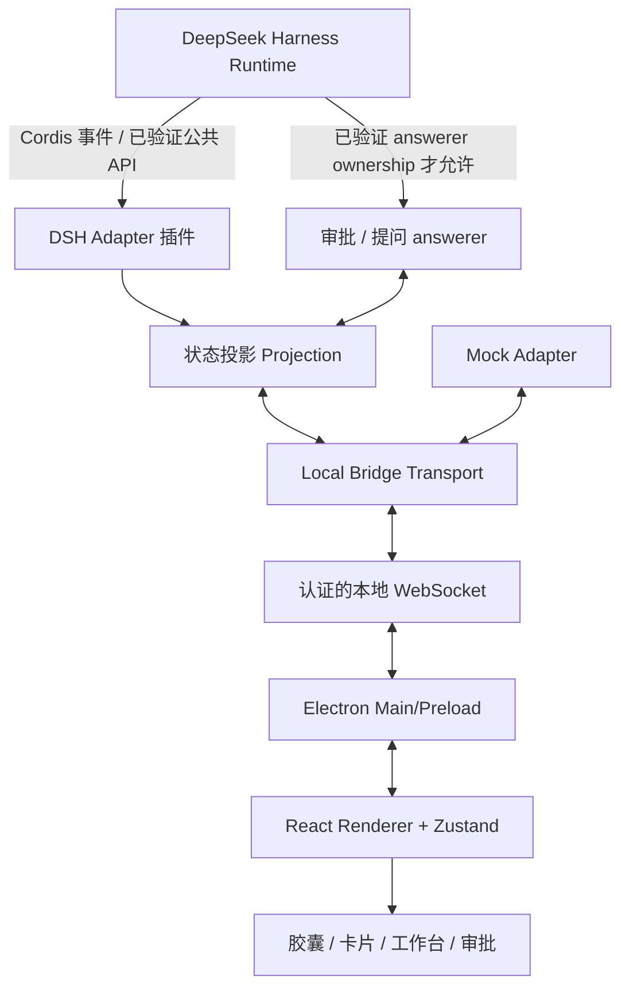
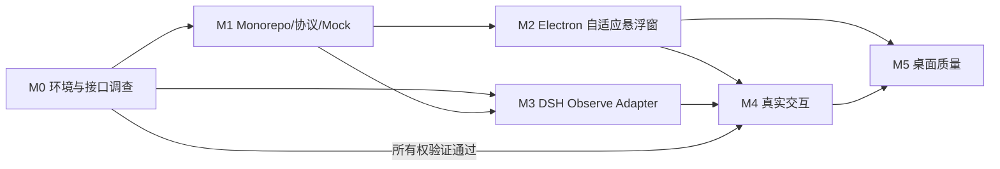
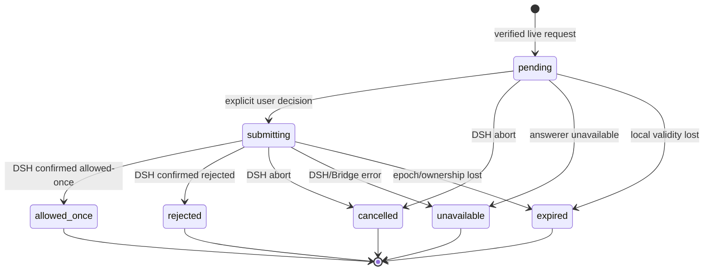
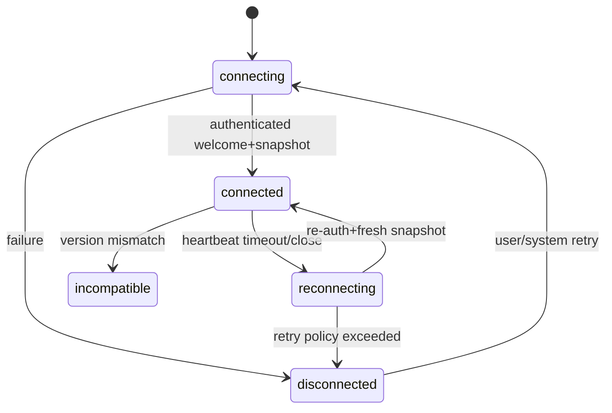

# DSH Glass — 完整开发规格（Codex 版）

> 本文件合并了全部 Markdown 开发文档，便于单文件输入 Codex。若存在差异，请以独立源文档为准。


---

<!-- SOURCE: README.md -->
# 文件：`README.md`

# DSH Glass — Codex-ready 开发规格包

> 版本：v1.0 | 文档日期：2026-10-17 | 目标平台：Windows 11 优先 | 目标产品：DeepSeek Harness (`dsh`) 桌面悬浮伴侣

**一句话定义**：以液态玻璃为视觉语言、可自由移动与伸缩的桌面窗口，让用户查看 DSH 会话任务、Todo、工具活动，并在已验证的授权通道中直接处理审批和结构化提问，无需切回 DSH 主窗口。

本仓库**是开发规格包，不是宣称已实现功能的源代码**。可以将其作为新项目根目录，交给 Codex 从 M0 逐步开发。

## 推荐阅读顺序

1. [AGENTS.md](AGENTS.md)：Codex 必须遵守的工程规则。
2. [docs/00_PRODUCT_PRD.md](docs/00_PRODUCT_PRD.md)：产品边界、用户场景和验收条件。
3. [docs/01_ARCHITECTURE.md](docs/01_ARCHITECTURE.md)：总体架构、组件边界和交互控制方案。
4. [docs/02_PROTOCOL.md](docs/02_PROTOCOL.md)：本项目**自定义**本地协议与数据类型。
5. [docs/03_UX_DESIGN.md](docs/03_UX_DESIGN.md)：交互状态、尺寸断点、设计系统。
6. [docs/04_DSH_INTEGRATION.md](docs/04_DSH_INTEGRATION.md)：官方已验证接口、可行性实验与待确认项。
7. [docs/05_SECURITY_TESTING.md](docs/05_SECURITY_TESTING.md)：威胁模型、测试矩阵和验收标准。
8. [docs/06_EXECUTION_PLAN.md](docs/06_EXECUTION_PLAN.md)：里程碑、先后关系、停工条件。
9. [docs/07_DECISIONS.md](docs/07_DECISIONS.md)：架构决策记录。
10. [docs/08_STATE_MODEL.md](docs/08_STATE_MODEL.md)：会话投影、状态机、乱序处理。
11. [docs/09_SOURCES.md](docs/09_SOURCES.md)：官方源地址、已确认事实与易变点。
12. TASKS.md：Codex 实施清单。
13. PROMPT_FOR_CODEX.md：新 Codex 会话的启动提示词。

## 范围约束

- 第一版主要服务 **Windows 11 x64**；macOS/Linux 暂不承诺。
- **不替代 DSH 本体**：不写代理模型、会话引擎、工具运行器。
- **观察先行，审批最后接入**：DSH Desktop 的交互所有权必须先验证。
- **不默认能接管 Desktop 审批**：`approval/request` 是 waterfall，不是广播。
- **不做未经证实的自动审批**；任何批准都需明确的人类点击。
- **无障碍与性能优先**：动态折射 Shader 为可选增强，不作为 MVP 阻塞项。

## 优先级说明

`P0` 必须实现：插件加载、会话观察、Todo、窗口拖拽缩放、自适应密度、连接/故障显示、真实审批可行性验证。

`P1`：真正的审批闭环（仅在 M1 通过后）、结构化提问、通知、跨屏/窗口恢复、多会话切换。

`P2`：动态边缘折射、主题市场、时间线高级搜索、跨平台支持。

## 启动方式（给 Codex）

在空项目目录放置全部文件，然后在 Codex 中打开此目录，粘贴 PROMPT_FOR_CODEX.md 中的首轮指令。**先执行 M0（环境与 DSH 接口核验），不要第一步直接写审批桥。**

建议初始技术栈：pnpm workspace、TypeScript strict、Electron、electron-vite、React、Tailwind、Zustand、Zod、Vitest、Playwright（桌面 E2E 实测视环境而定）。具体版本锁定到实际兼容版本后写入锁文件，避免套用未经验证的模板版本。

## 验收的最终定义

1. DSH 主窗口不在前台时，Glass 仍能展示实际任务状态。
2. Todo 更新及时且恢复连接后不会回退到旧状态。
3. 悬浮窗按空间重排信息，安全操作始终可访问。
4. 已验证授权模式下，允许/拒绝可反馈真实的 DSH 决策；失联、过期、撤销请求绝不自动放行。
5. Windows DPI、显示器切换、休眠唤醒、关闭恢复、重复启动下稳定运行。

见 [验收测试](docs/05_SECURITY_TESTING.md) 与 [执行路线](docs/06_EXECUTION_PLAN.md)。


---

<!-- SOURCE: AGENTS.md -->
# 文件：`AGENTS.md`

# AGENTS.md — DSH Glass Codex 工程指令

你是此仓库的实现工程师，需严格遵守本文，优先保证可验证、可测试和安全失败，而非快速堆砌 UI。

## 0. 当前任务起点

- 本仓库最初只含规格文档。**从 `TASKS.md` 的 M0 开始**；一次只推进一个可验证里程碑。
- 开发第一步：读取 `README.md`、`docs/04_DSH_INTEGRATION.md`、`docs/06_EXECUTION_PLAN.md`、`TASKS.md`。
- 检测 Windows/Node/pnpm/DSH Desktop/CLI 环境与实际安装路径；版本写进 `docs/09_SOURCES.md` 的“本地验证记录”节。
- 如无法访问 DSH 源码或运行环境，使用 Mock Adapter 推进窗口/UI，但将真实接入标记 `BLOCKED`；**不得把 Mock 宣称为真实联通**。

## 1. 设计红线

1. 不更改官方 DSH 已安装应用、签名资源、Profile 数据或配置，除非用户明确授权且已提供恢复措施。
2. 不采集或上传用户的模型密钥、命令环境变量、全量聊天内容；默认仅做最小数据传输。
3. 不擅自添加“始终允许”或自动审批功能。唯有真实 `allowed-once` 才是授权成功。
4. `approval/request` 是 **waterfall**；未经实证不能旁路监听并抢占 Desktop 原有回答者。
5. 未验证 UI 所属 Session/Agent/请求身份之前，禁用审批按钮；断线/撤销/超时均 **fail closed**。
6. Todo 使用**整表快照**和**会话范围**，不能把同一个列表当作多个 Agent 共用。
7. DSH 事件签名来自目标版本源码与官方生成文档；自定义事件类型与 DSH 原生类型严格隔离。
8. Electron `nodeIntegration: false`、`contextIsolation: true`、`sandbox: true`；renderer 不直接访问 Node、文件系统或 WS token。
9. 不实现隐蔽后台进程、键盘记录、全局任意窗口抓取、未经授权端口服务。
10. 未经确认，不向用户或仓库文档声称已验证真实 DSH Desktop 审批功能。

## 2. 实施策略

- Monorepo：`apps/desktop`、`packages/protocol`、`packages/bridge`、`packages/adapters/mock`、`packages/adapters/dsh`。
- 所有网络帧进来后先 schema 验证，再交给 Store；UI 不解析原始 DSH 事件。
- Bridge 和 Adapter 不导入 React/Electron 渲染依赖；window API 通过窄 preload 暴露。
- 业务行为由纯函数和状态机实现；测试覆盖乱序、重连、重复点击、跨 Session 误路由。
- 可见 UI 文案中文优先；代码标识符、类型及关键日志使用英文。
- 为新增公共协议结构添加对应测试与 `docs/02_PROTOCOL.md` 更新。
- 视觉层优先 CSS/系统材质；性能预算无法达到时自动降级，不能掩盖错误或降低审批可读性。

## 3. 每个任务的 Definition of Done

- 实际代码/配置可运行，`pnpm lint`、`pnpm typecheck`、`pnpm test` 通过（在脚本创建后）；未通过要标出根因。
- 新行为配最小单元或集成测试；涉及窗口与审批需提供手动验证步骤。
- 修改 `TASKS.md` 中对应项 `[ ] → [x]`，附一行验证证据；阻塞项仍保持 `[ ]` 并注明阻塞因素。
- 不将测试失败改成空断言；不使用 `any` 掩盖缺陷；不将鉴权检查删除以“先跑通”。
- 形成简短变更报告：新增文件、已验证能力、未验证能力、下一步。

## 4. 决策优先级

安全 > 数据正确性 > 主功能可用性 > 用户可控性 > 性能 > 液态玻璃炫技。

遇到 DSH 官方文档与本规格冲突：以**目标版本源码和可复现测试**为准，更新相应文档并给出证据；切勿硬套此文档的假设。

## 5. 禁止“假实现”

- 不能只播放循环进度动画冒充 Agent 工作；无状态时显示“尚无会话”或“未连接”。
- 不能用假按钮点击后修改 UI 状态来冒充已审批；必须等待 DSH 决议事件或明确 ACK。
- 不能以抓取网页 DOM 代替受控的正式接口，除非另行形成 ADR、明确风险并取得用户同意。


---

<!-- SOURCE: TASKS.md -->
# 文件：`TASKS.md`

# DSH Glass — 实施任务清单

说明：以下均为**待执行任务**，勾选需附证据（测试、截图、日志或提交链接），不能仅凭实现意图标记完成。状态 `BLOCKED` 须写明原因。

## M0 — 环境与可行性探测（P0）
- [ ] M0-01 收集 OS、Electron/Node/pnpm、DSH CLI/Desktop 版本及安装方式。
- [ ] M0-02 阅读目标 DSH 版本官方源码：`session/event`、`approval/request`、`user-questions/request`、`todo/write`。
- [ ] M0-03 验证 Web Profile 以正常插件形式启动，输出真实 Session 事件。
- [ ] M0-04 验证 Desktop Profile 是否可以安全安装启用 Bridge 插件（无修改已签名资源）。
- [ ] M0-05 审批 answerer 所有权探测：官方 Desktop UI 与 Glass 如何保证仅一个回答者；失败则确认观测模式可用。
- [ ] M0-06 记录支持矩阵和接口快照，明确第一版目标构建方式。

## M1 — 可测试的基础设施（P0）
- [ ] M1-01 pnpm monorepo + workspace 脚本 + TypeScript strict。
- [ ] M1-02 `packages/protocol`：Schema、解析验证、类型与协议版本。
- [ ] M1-03 `packages/adapters/mock`：确定性 Mock 事件流、延迟/乱序/断线测试模式。
- [ ] M1-04 `packages/bridge`：单实例本机 Transport、鉴权、连接生命周期。
- [ ] M1-05 Session Store：快照、增量、顺序与跨会话隔离。
- [ ] M1-06 单测：重复消息、旧 epoch、错误 payload、Todo 整表替换。

## M2 — 桌面窗口和自适应 UI（P0）
- [ ] M2-01 Electron 主进程：单实例、托盘、关闭行为、窗口尺寸记忆。
- [ ] M2-02 Preload 白名单 IPC（禁止在 renderer 开 Node）。
- [ ] M2-03 可拖拽、可调整尺寸、磁性吸附、跨屏恢复。
- [ ] M2-04 胶囊/紧凑/工作台布局与高度不足时滚动降级。
- [ ] M2-05 状态 UI：未连接/运行/等待/完成/失败、无 Todo 和多个 in_progress。
- [ ] M2-06 玻璃主题（原生材质优先，CSS 降级）与减少动画选项。
- [ ] M2-07 快捷键和置顶开关可用，避免覆盖全屏应用。

## M3 — DSH 观察模式（P0）
- [ ] M3-01 构建 Cordis DSH Adapter 插件，能被目标 Profile 加载。
- [ ] M3-02 监听或通过受支持 API 获取持久会话事件。
- [ ] M3-03 `todo/write` 完整快照投影，sessionId 隔离。
- [ ] M3-04 关联 `tool/call` 与结果，输出脱敏摘要；未验证的内容标记缺失。
- [ ] M3-05 获取真实状态和重连快照；模型思考中与未知状态不伪装成准确进度。
- [ ] M3-06 不启动 DSH 主窗口时的稳定性/生命周期测试。

## M4 — 人工交互闭环（P0/P1，**取决于 M0-05 是否通过**）
- [ ] M4-01 验证审批 answerer 所有权与请求生命周期，形成 ADR。
- [ ] M4-02 审批请求显示 toolName/callId/原始命令摘要；完整参数缺失时限制危险批准。
- [ ] M4-03 单次允许/拒绝；等待真实决议确认后改变 UI。
- [ ] M4-04 处理 cancelled/unavailable、断线、重复点击、过期、并发。
- [ ] M4-05 用户问题（结构化选项/文本）验证与回答闭环。
- [ ] M4-06 多 Session 多请求路由隔离测试。

## M5 — 质量、打包与发布（P1）
- [ ] M5-01 Windows 11 22H2+、DPI 100/125/150/200% 检查。
- [ ] M5-02 多屏/休眠唤醒/异常重启/重复启动检查。
- [ ] M5-03 性能基线 + 禁用 Shader 降级策略。
- [ ] M5-04 用户配置、开机启动（默认关闭）、卸载清理。
- [ ] M5-05 构建未签名本地测试安装包，明确 Windows 安全提示。
- [ ] M5-06 用户使用文档、已知限制、安全说明、日志脱敏审核。

## 后续扩展（P2）
- [ ] 多 Agent 统一抽象与插件接口。
- [ ] 完整事件时间线搜索与筛选。
- [ ] 高级实时边缘光学效果。
- [ ] macOS/Linux 技术评估。


---

<!-- SOURCE: PROMPT_FOR_CODEX.md -->
# 文件：`PROMPT_FOR_CODEX.md`

# 给 Codex 的首轮开发指令（直接复制下文）

你现在负责实现 DSH Glass —— 一个 Windows 11 上的 DeepSeek Harness 液态玻璃悬浮伴侣。此目录含完整产品与技术规格。请先完整阅读 README.md、AGENTS.md、TASKS.md、docs/04_DSH_INTEGRATION.md、docs/06_EXECUTION_PLAN.md、docs/09_SOURCES.md。

**本轮只执行 M0 + M1 的第一个最小可交付闭环**，具体如下：

1. 检查当前工作目录和开发环境，包括 OS、Node、pnpm、DSH CLI/官方 Desktop 是否安装、版本，以及能否找到其公开接口/源码。不要修改官方 DSH 安装本身。
2. 根据文档初始化 pnpm TypeScript Monorepo，包含 apps/desktop、packages/protocol、packages/bridge、packages/adapters/mock、packages/adapters/dsh 等目录。建立 lint/typecheck/test 脚本与 strict tsconfig。
3. 实现一个可启动的 Mock Adapter，通过自定义协议提供连接状态、会话、完整 Todo 快照、工具事件和模拟审批请求。Mock 数据必须显著标注 Mock，不得与真实 DSH 数据混淆。
4. 实现 Windows Electron 悬浮窗的最小端到端闭环：无边框、可拖动、可调整大小、3 个信息密度断点、Zustand Store、连接断开提示、基本玻璃材质降级。
5. 探测官方 DSH 的 `session/event` 和 `approval/request` 真正可用的接入方式，记录证据，不要在未验证所有权前注册抢占式审批 answerer。
6. 给核心协议与 Todo 投影写测试（完整快照覆盖、按 Session 分开、断线失效）。最后运行全部可用检查并填写 TASKS.md。

请使用小步提交式工作流：每一步给出文件变更和测试结果；若无法连接真实 DSH，继续完成 Mock UI，但将真实集成标记为 BLOCKED。不要基于猜想创造 DSH 原生 API。遇到已验证的官方 API 变化请更新文档。最终输出“已完成 / 未完成 / 风险 / 下一步”的工作总结。


---

<!-- SOURCE: docs/00_PRODUCT_PRD.md -->
# 文件：`docs/00_PRODUCT_PRD.md`

# 00 — 产品需求文档（PRD）

版本 v1.0，2026-10-17。状态：**待研发/待实际集成验证**。

## 1. 背景与问题

DSH 执行长任务时，用户往往同时做其他工作。为了知道 Agent 是否在运行、已经完成哪些步骤、是否需要审批，用户需要反复切换回 DSH 主窗口。这增加上下文切换成本。DSH Glass 是一个桌面级“第二界面”，压缩信息、及时通知，并在明确安全边界下允许人工决策。

## 2. 产品目标

- **G1 观察**：实时知道当前 DSH 会话状态、当前 Todo、最近工具活动；悬浮窗不依赖 DSH 主窗口处于前台。
- **G2 决策**：当 DSH 要求工具授权或用户回答时，在悬浮窗中看到足够上下文并直接提交；仅对目标 Profile/版本经验证的方式开放。
- **G3 轻量**：不打断正在进行的学习、编程、全屏活动；小体积悬浮，用户可决定置顶和自动展开。
- **G4 高级视觉**：液态玻璃是产品特色，但必须保持清晰、可降级、低负载。
- **G5 可维护**：封装 DSH 接口，允许 DSH 开发预览版频繁变化，保持 UI 与通信协议相对稳定。

## 3. 非目标

- 不复刻 DSH 的整个对话窗口；不直接编辑 Agent 的 system prompt；不提供自定义模型调用。
- 不读取屏幕像素、OCR 或操纵官方窗口鼠标作为默认集成方法。
- 不把多个 Session 的 Todo 合并成真实共用列表。
- 不在没有受支持应答通道的情况下伪造审批。
- MVP 不支持任意自动授权、不需管理员权限、不隐式代理外网。

## 4. 使用场景与用户故事

### US-01：不切回主窗口查看任务（P0）
**给定** DSH 有正在运行的 Session；**当** 用户把 DSH 主窗口置于后台；**那么** 悬浮窗显示当前会话、当前执行状态、Todo 进度及最新已验证事件。若 DSH 不再工作，应显示“已断开”，不能永久显示运行中。

### US-02：默认胶囊常驻（P0）
**给定** 悬浮窗宽约 180px；**当** 用户单击胶囊；**那么** 窗口展开到用户上次使用的工作台大小；双击指定抓手可以收回；窗口能够拖动至屏幕任意安全区域。

### US-03：自由缩放时信息重新编排（P0）
**给定** 窗口从 180×54 逐渐放大到 520×620；**那么** 布局应由状态指示 → 简洁当前任务 → Todo 列表 → 完整活动详情，不出现小字体暴力缩放、溢出或关键按钮被截断。

### US-04：审批可读且可提交（P0 条件能力）
**给定** DSH 的受支持授权通道已验证可用；**当** 收到 `approval/request`；**那么** UI 显示目标 Session、工具名、请求原因、callId 及关联的工具参数信息；用户选择“允许一次”或“拒绝”后，按钮禁用直到收到真实结果；断线、取消或身份不一致时按钮不可用。

### US-05：回答 Agent 问题（P1）
**给定** DSH 请求结构化提问；**那么** 展示问题、可选择选项、多选/自定义输入；提交后以 DSH 实际应答为准。不能把它误标为工具审批。

### US-06：两个不同项目同时工作（P1）
**给定** 两个 Session 分属不同 Workspace；**那么** 可切换聚焦 Session，并对不同 Session 显示各自 Todo 与审批队列；绝不提交到错误 Session。

### US-07：窗口跨显示器恢复（P1）
**给定** 用户把窗口放在外接显示器边缘；**当** 外接显示器断开或 DPI 改变；**那么** 窗口重新定位到可见工作区，尺寸在最小和最大值之间，并保留上次合理布局。

### US-08：注意力管理（P1）
**给定** 用户开启安静模式；**那么** 常规工具活动不弹出通知，重要请求在胶囊上增加醒目计数，可由用户选择是否自动展开；全屏应用中默认不强制覆盖。

### US-09：异常恢复（P0）
**给定** Bridge 断开、客户端休眠或 DSH 重启；**那么** 显示失联状态、禁用全部待提交交互，重新握手和拉取快照后再允许决策。

## 5. 需求列表

| ID | 优先级 | 行为 | 验收方式 |
|---|---|---|---|
| F-01 | P0 | 连接状态分辨 connected/reconnecting/disconnected/incompatible | 模拟网络中断和重连 |
| F-02 | P0 | 真实 Session 按身份列出，显示最新事件时间 | 一次真实 DSH 测试 |
| F-03 | P0 | Todo 逐 Session 完整覆盖更新 | 单测：删除 Todo 后旧项消失 |
| F-04 | P0 | 当前状态 + 近期工具摘要 | 仿真和真实日志比对 |
| F-05 | P0 | 拖动、置顶、缩放、布局断点 | Windows 手测 |
| F-06 | P0 | 审批能力探测 + 安全禁用 | 未授权时无法批准 |
| F-07 | P0 条件 | `allowed-once` / `rejected` 真实决议 | 端到端记录审计事件 |
| F-08 | P1 | 结构化提问回答 | 受支持模式 E2E |
| F-09 | P1 | 多 Session 选择 + 待处理数 | 并发测试 |
| F-10 | P1 | 通知、安静模式、自动展开开关 | 行为/UI 测试 |
| F-11 | P1 | 托盘、快捷键、启动/关闭设置 | OS 手测 |
| F-12 | P1 | 主题、自适应玻璃和降级 | 不同背景、显示缩放视觉检查 |
| F-13 | P2 | 历史事件搜索、任务聚合、动态折射 | 后续迭代 |

## 6. 数据呈现规范

- **Todo 进度是数量比例**：完成数 / Todo 总数，并明确标注“步骤”而不是“整体时间完成百分比”。无 Todo 时隐藏百分比。
- **“当前任务”**：取最后完整 Todo 快照中 `in_progress` 的项目；可能有多个，须支持多项列表。无 `in_progress` 不代表任务完成。
- **最近活动**：来自真实已提交事件，工具参数可由 `callId` 关联，但要脱敏且有上限；不能展示推测的活动。
- **思考中**：仅在目标版本提供可靠状态事实时显示；否则显示“处理中/等待新事件”。
- **完成**：区分“某步骤完成”和“整个 Turn / Session 已结束”；不可仅凭 Todo 全完成宣称整个 Agent 运行完成。

## 7. 交互原则

- 用户不会因为窗口自动调整而失去焦点；自动展开不应抢夺输入焦点（除非系统 API/用户明确配置）。
- 重要交互优先：待审批数量优先于背景动画；完整工具参数可按需展开。
- 禁止惊喜操作：没有自动批准、没有未经用户同意的永远置顶、不擅自开机自启。
- 用户要有“一键打开原始 DSH 会话”的可用退路；只有当 deeplink 由实际版本验证存在时才使用，否则给出手动跳转或主窗口激活。

## 8. 非功能要求

- 安全：无密码明文日志；不开放到局域网；未经授权来源无法发起批准；失联 fail closed。
- 可靠性：重复/乱序事件不能使 Todo 回退；跨会话身份严格隔离。
- 性能目标（**设计预算，非已实测数据**）：空闲渲染低频、无持续 60fps Shader；在开发机上测量 CPU/GPU/内存与刷新频率，确认不影响后台编译任务。发布前测量真实数据，不预设硬性虚构数值。
- 无障碍：不依赖颜色独自表达状态；键盘可操作；文字在浅/深色背景都可读；尊重系统 reduced-motion。
- 兼容性：Windows 11 22H2+ 优先，Windows 10 提供非系统材质降级（其余行为需测试）。

## 9. 发版门槛

对用户可见的“可审批”功能必须满足 M0 所有权验证 + M4 全套安全测试。若无法通过，**产品可以以观察模式 Beta 发布，但必须明确标注“审批暂不支持当前 DSH Desktop 版本”**。


---

<!-- SOURCE: docs/01_ARCHITECTURE.md -->
# 文件：`docs/01_ARCHITECTURE.md`

# 01 — 技术架构与组件边界

## 1. 核心思路

采用**可替换 DSH Adapter + 本机 Bridge + 独立 Electron Window** 的架构，不对已签名官方 DSH Desktop 可执行资源做任何修改。



注意：图中的 DSH `AC` 只代表**经过证明的可选集成模块**；在官方 Desktop answerer 所有权未验证前**不得启用**。

## 2. 建议仓库结构

```text
dsh-glass/
├─ apps/desktop/
│  ├─ electron/main/          # BrowserWindow/tray/IPC/连接生命周期
│  ├─ electron/preload/       # 类型化白名单 IPC
│  └─ src/
│     ├─ features/{capsule,todo,approval,question,sessions}/
│     ├─ components/glass/
│     ├─ stores/
│     ├─ styles/
│     └─ app/
├─ packages/
│  ├─ protocol/              # 协议 Schema/TS 类型，前后端共享
│  ├─ bridge/                # 本机鉴权 / WS / 事件缓存 / ACK
│  └─ adapters/
│      ├─ mock/               # 无 DSH 时的确定性演示源
│      └─ dsh/                # Cordis 插件 + API capability 实验
├─ docs/                     # 本规格包
├─ tests/                    # integration/e2e/fixtures
├─ AGENTS.md
└─ TASKS.md
```

## 3. 组件职责

### DSH Adapter

- 在运行时进程中从**真实** DSH 事件/服务获取变化。
- 采用会话身份映射 `runtimeId + sessionId`，准确提取持久事件序号（若版本提供）。
- 提供 `getSnapshot()` 或适配器等价能力（需要 target DSH 版本验证）；无 API 时采用可证明的重建策略。
- 不关心窗口状态/视觉，不持有 Electron 对象。
- 不在未经所有权确认前注册工具审批 answerer；只展示已可安全获取的审计事实。

### State Projector

- 将真实 session log、agent 状态转为 `SessionView`，不泄露原始对象引用。
- Todo 整体替换，按 Session 单独存储。
- 以 `callId` 将请求与已经流出的 `tool/call` 关联，工具参数受脱敏策略保护。
- `session.status` 不足以推断是否正在等待人类时，以独立 pending request 状态表示。
- 会话关闭或连接中断时，将审批状态降为不可提交。

### Local Bridge

- 默认仅绑定 `127.0.0.1`，不对外暴露端口；随机令牌启动/轮换。
- 每个客户端认证且最小权限；握手检查 `protocolVersion`、`sourceRuntimeId`、capabilities。
- 向 UI 发送有版本的快照和增量；支持可恢复重连。
- 接受 `approval.respond` 请求时校验 UI 请求身份、epoch、Session owner、pending 状态、防重放。
- 不做自动授权；提交后真实决议才回 ACK。

### Electron Main & Preload

- 单实例锁、托盘、窗口放置、多屏、DPI、关闭/隐藏、热键与置顶。
- Renderer 沙盒化，无任意 IPC；Bridge token 存于 Main 进程，preload 只暴露窄且类型化的方法。
- 不允许通过外部链接调用系统 shell 或打开任意文件。
- IPC channel 只包含窗口 UI 需要的命令及数据，协议层校验每个 payload。

### React Renderer

- 根据已归一化 ViewModel 渲染，**不直接调用 DSH Cordis、SDK 或文件系统**。
- 展示不同信息密度断点与用户偏好；兼容键盘与 reduced-motion。
- 审批按钮只产生提交意图，最终状态来自服务端确认。

## 4. Observe/Control 双能力模式

| 模式 | 数据来源 | 是否可提交决策 | 何时启用 |
|---|---|---|---|
| mock | MockAdapter | 仅虚拟数据，绝不触发真实操作 | 日常 UI 开发 |
| observe | DSHAdapter | 不可以 | 接入验证成功，审批通道未知 |
| control | DSHAdapter + verified answerer | 可以（逐个请求显式批准） | Ownership、安全 E2E 全通过 |

启动时通过 `capabilities` 广播精确能力；UI 不允许根据“看到了审批事件”推断可提交审批。

## 5. 关键设计问题

### Q1：如何同时使用官方 DSH Desktop 和 Glass？

Desktop Profile 与 CLI Web Profile 分离。必须先验证官方 Desktop 的插件管理器是否允许正常加载插件，以及插件所在进程与 Session owner 是否一致。不能使用 `dsh --profile desktop` 命令绕过官方限制，不能改装已签名 `app.asar`。

优先路线：**官方 Desktop 插件功能加载独立 dsh-adapter，Bridge 通过正常插件进程对外提供能力**。若无法完成，优先交付 Web Profile 的观察版或官方 Desktop 的只读公共 API 适配，而不是盲目对接内部私有端口。

### Q2：审批请求可否通知多个 UI？

`approval/request` 是 waterfall：首个 owner answerer 决定，请求不能由两个 UI 任意竞争。因此控件入口必须通过所有权可验证的“唯一决策者”或支持的上游协作方式完成。若无安全支持，只读并使用“在 DSH 处理”入口。不得在日志层仅看到 `approval/asked` 后伪造 answerer。

### Q3：如何避免瞬时状态不一致？

Bridge 初次连接或重连生成完整快照，并以 generation/epoch 标记，客户端只接受匹配会话的增量。不能仅使用网络到达顺序；每条增量以 source sequence 去重，并在 gap 出现时触发 `snapshot.request`。

### Q4：用户退出 Glass，DSH 会怎样？

仅退出悬浮层，不主动停止 DSH Agent，也不替代 DSH 的生命周期管理。控制模式若 Glass 唯一持有 answerer，退出前必须先将所有待决请求以安全方式退回/失败关闭，并向用户说明：不能保证原 DSH UI 会接管。后台无法运行时退回 observe 模式或明确不可用。

## 6. Windows 窗口技术边界

Electron 无边框窗口 + `resizable: true`。系统背板使用 `setBackgroundMaterial('acrylic')`，**前提 Windows 11 22H2+** 且实际窗口参数兼容；失败时 CSS 半透明模糊材质降级。不要仅靠网页 `backdrop-filter` 声称实现了系统级桌面模糊；必须实测组合是否有效。

- 主窗口透明并不等于 Acrylic 可用；将“native acrylic supported”作为独立 capability。
- `setIgnoreMouseEvents` 必须有可靠的恢复入口（托盘/快捷键），审核交互下默认关闭。
- 拖拽区使用 `app-region: drag`（具体 Electron 版本验证），按钮等交互元素 `no-drag`。
- 窗口的像素空间使用 Electron 的 DIP（逻辑像素）并根据 display workArea 恢复边界。

## 7. 数据持久化

持久化**本地偏好**（主题、尺寸、位置、置顶、安静模式），而非原始 DSH 会话或聊天记录。存储使用 schema version 和配置迁移。禁止明文存 WS token；默认每次进程启动刷新 token。

## 8. 推荐依赖关系

`protocol` ← `bridge` / `desktop` / `dsh-adapter` / `mock-adapter`; `bridge` ← `dsh-adapter` 与 `mock-adapter`（接口注入）；`desktop` 只依赖 protocol 与 Bridge 客户端，尽量不直接加载 DSH runtime package。


---

<!-- SOURCE: docs/02_PROTOCOL.md -->
# 文件：`docs/02_PROTOCOL.md`

# 02 — DSH Glass 本地通信协议（项目自定义，不是 DSH 原生 API）

**重要**：本文的 `glass.*`、`session.*`、`approval.*` 消息均为本项目**自定义传输协议**。不可将其当成 DSH 官方事件名或现成接口。DSH 原始事件在 Adapter 内转换。

## 1. 传输规范

- 默认 transport：单机 `ws://127.0.0.1:<ephemeralPort>`，端口由系统分配；Windows 用户目录或 Main-Bridge 已认证本地 IPC 传递地址和认证 token，永不暴露给 renderer。
- Bridge 限制可接入客户端、请求来源、最大 payload（建议默认 256 KiB；工具详情应按需分页）、并发与每秒消息频率；超过限制断开连接并记审计日志（脱敏）。
- 统一 envelope：`protocolVersion`, `messageId`, `kind`, `sentAt`, `runtimeId`, `epoch`, `payload`；命令响应额外 `correlationId`。
- `epoch` 是 Bridge 生命周期/源会话投影代数（启动及不可恢复重置时变化），与 source 的 `seq` 分离。
- 所有事件源数据都必须通过 Zod schema 校验并转换成 ViewModel；不能把 Cordis 运行时引用序列化到 UI。

## 2. JSON envelope 样例

```json
{
  "protocolVersion": 1,
  "messageId": "msg-48",
  "kind": "session.todo.snapshot",
  "sentAt": "2026-10-17T01:00:00.000Z",
  "runtimeId": "runtime-local-a",
  "epoch": "epoch-b138",
  "payload": {
    "sessionId": "s-001",
    "sourceSeq": 181,
    "todos": [
      { "content": "分析性能瓶颈", "status": "completed" },
      { "content": "优化 Tiling 参数", "status": "in_progress" },
      { "content": "执行回归测试", "status": "pending" }
    ]
  }
}
```

该样例是**Mock 数据**。

## 3. 参考类型（实现时必须以 Zod schema 为唯一运行时校验来源）

```typescript
type ConnectionState =
  | 'connecting' | 'connected' | 'reconnecting'
  | 'disconnected' | 'incompatible';

type TransportCapabilities = {
  observeSessions: boolean;
  observeTodos: boolean;
  observeTools: boolean;
  respondApproval: boolean;
  respondQuestion: boolean;
  supportsNativeAcrylic?: boolean; // 由桌面客户端能力汇报
};

type Todo = {
  content: string;
  status: 'pending' | 'in_progress' | 'completed';
};

type SessionView = {
  runtimeId: string;
  sessionId: string;
  workspaceLabel?: string;
  title?: string;
  connectionState: ConnectionState;
  agentStatus: 'running' | 'idle' | 'unknown';
  phase: 'working' | 'waiting-approval' | 'waiting-question'
    | 'finished' | 'error' | 'unknown';
  todos: Todo[];
  lastEventAt?: string;
  lastSourceSeq?: number;
};

type ApprovalView = {
  requestId: string;
  runtimeId: string;
  sessionId: string;
  toolName: string;
  callId?: string;
  reason?: string;
  commandPreview?: string;   // 安全脱敏后，由已验证源提供
  displayDetails: 'complete' | 'partial' | 'unknown';
  status: 'pending' | 'submitting' | 'allowed-once'
    | 'rejected' | 'cancelled' | 'unavailable' | 'expired';
  actionable: boolean;
  createdAt: string;
  sourceEpoch: string;
};

type UserQuestionView = {
  requestId: string;
  runtimeId: string;
  sessionId: string;
  questions: Array<{
    id: string;
    question: string;
    options?: Array<{ label: string; description?: string }>;
    multiSelect?: boolean;
    allowCustom?: boolean;
  }>;
  actionable: boolean;
};
```

`ApprovalView.actionable` 只能由 Bridge 的已验证所有权与请求有效性状态计算，UI 不得自行设 true。

## 4. 消息清单

| kind | 方向 | payload 关键字段 | 说明 |
|---|---|---|---|
| `glass.hello` | desktop→bridge | protocolVersion, clientNonce | 握手，认证通过后获取能力 |
| `glass.welcome` | bridge→desktop | runtimeId, epoch, capabilities | 版本和能力确认 |
| `glass.heartbeat` | 双向 | monotonic counter | 存活检测；时钟不作排序依据 |
| `glass.snapshot.request` | desktop→bridge | reason | 首连/断层时取全量 |
| `glass.snapshot` | bridge→desktop | sessions, approvals, questions, lastSeq map | 原子投影快照 |
| `session.updated` | bridge→desktop | sessionId, sourceSeq, fields | 顺序状态更新 |
| `session.todo.snapshot` | bridge→desktop | sessionId, sourceSeq, todos | 整表替换 |
| `session.tool.activity` | bridge→desktop | sessionId, sourceSeq, toolName, callId, summary | 脱敏工具事件 |
| `approval.requested` | bridge→desktop | ApprovalView | 待审批/仅观察状态 |
| `approval.respond` | desktop→bridge | requestId, sessionId, epoch, decision | 用户意图，不直接代表批准成功 |
| `approval.ack` | bridge→desktop | correlationId, requestId, status, outcome? | 实际结果/不可用状态 |
| `approval.resolved` | bridge→desktop | requestId, outcome | 异步请求结束（来源验证） |
| `question.requested` | bridge→desktop | UserQuestionView | DSH 提问 |
| `question.respond` | desktop→bridge | requestId, answers | 结构化回答意图 |
| `glass.error` | bridge→desktop | code, correlationId?, safeMessage | 安全错误解释 |

## 5. 初始同步与重连算法

1. Renderer 通过受限 preload 请求连接；Main 负责 token 握手。
2. Bridge 返回 `glass.welcome`；校验协议版本与已验证 capabilities。
3. Client 发出 `glass.snapshot.request`；收到 `glass.snapshot` 后**原子替换**本地 runtime 投影。
4. 只接收当前 epoch 和 runtimeId 匹配的增量。按 Session+源序号去重；**只有源头提供完整连续的 Session 事件流时**才可以将序号 gap 视为丢消息并触发重拉快照。如果只订阅 `todo/write` 等过滤后的事件，非连续序号是正常现象，必须改用独立的传输连续序号或按需重拉快照。
5. 如果底层 DSH 事件不是连续序号，Adapter 必须提供单调本地序号与可恢复语义，不能伪称原生 `seq`。
6. 断线立刻将全部审批置为不可操作、状态标为 stale；丢弃所有本地未发送意图，重连后不得自动重发“允许”。
7. 重连后从 authoritative pending set 重建请求队列；已经结束/失去所有权的审批不能出现为 actionable。

## 6. 审批事务约定

客户端提交：

```json
{
  "protocolVersion": 1,
  "messageId": "msg-approve-123",
  "kind": "approval.respond",
  "sentAt": "2026-10-17T01:00:03.000Z",
  "runtimeId": "runtime-local-a",
  "epoch": "epoch-b138",
  "payload": {
    "sessionId": "s-001",
    "requestId": "approval-009",
    "decision": "allowed-once",
    "clientCommandId": "client-cmd-91"
  }
}
```

- 这里的 `requestId` 是 DSH Adapter 映射过来的**真实审批请求身份**，不同于 `callId`；不能混用。
- 用户点击后 UI 立刻禁用按钮，进入 `submitting`；Bridge 校验所有权/有效性/幂等键/来源会话/epoch。
- `approval.ack status='accepted'` 只代表 Bridge 已接受意图，**不是 DSH 已允许**。只有官方 answerer 回调已完成并证实 outcome 后才能发送 `resolved`。
- 桥接端处理失败须返回 `rejected-by-bridge`（协议错误含义，不等同于 DSH `rejected`），不得伪造 `allowed-once`。
- 客户端超时后显示“状态未确认，请在 DSH 中核实”；绝不自动重试允许请求。允许请求在任何条件下都不得跨 epoch 重放。

## 7. 显示和隐私

- `commandPreview` 是 UI 摘要，不作为批准操作的唯一信息来源；若不完整，必须有按需读取的完整、可验证详情入口或禁用审批并跳转 DSH。
- 工具调用/参数在日志、缓存、WebSocket 和通知中执行最小化及脱敏；不应在通知预览显示环境变量密钥。
- 大型日志限制长度并裁剪，以受控主动请求加载详情。

## 8. 版本协商

当前开发协议 `protocolVersion = 1`。主版本不一致时 `ConnectionState='incompatible'`，禁止控制操作但允许显示可识别错误。协议字段做向前兼容时新增可选字段；更改含义必须升版本。


---

<!-- SOURCE: docs/03_UX_DESIGN.md -->
# 文件：`docs/03_UX_DESIGN.md`

# 03 — UX / Liquid Glass 视觉与窗口交互规范

## 1. 视觉目标

“轻量、真实玻璃质感、存在感低但重要时清楚可见”。不是为了折射而牺牲可读性。窗口被认为是 Agent 的状态指示器兼控制器，不是第二个聊天应用。

## 2. 布局断点（使用 Electron DIP，而非物理屏幕像素）

| 类型 | 典型尺寸 | 可见信息 | 交互 |
|---|---:|---|---|
| Capsule | 180×54 | 品牌缩写、状态灯、当前完成数/审批角标 | 单击展开，拖动移动 |
| Compact | 280×140 | 当前 Session、状态、当前任务摘要、步骤数 | 展开、会话跳转 |
| Task Card | 340×280 | 当前 Todo、简要时间线、连接状态 | Todo 滚动、查看请求 |
| Workspace | 420×480 | 完整 Todo、活动、Session 切换与 pending request | 完整交互 |
| Expanded | 520×620+ | 详细工具参数、审批、时间线，可在空间允许时双栏 | 深入查看 |

**真正的布局规则**：使用 `ResizeObserver` 监听内容容器宽度和高度；高度不足时进入可滚动紧凑视图，不以窗口总宽度判断一切。适配系统缩放与辅助字体大小。最低可访问尺寸以运行测试结果为准，审批面板本身不得强塞进 180×54。

## 3. 视觉 token 初值（可调，不是固定物理正确值）

```css
:root {
  --glass-radius: 24px;
  --glass-stroke: rgba(255,255,255,.34);
  --glass-surface-dark: rgba(18,24,35,.70);
  --glass-surface-light: rgba(245,248,252,.73);
  --glass-blur: 30px;
  --glass-border-width: 1px;
  --glass-shadow: 0 18px 48px rgba(0,0,0,.22);
  --motion-fast: 180ms;
  --motion-standard: 260ms;
  --status-running: #61a7ed;
  --status-approval: #e5ac59;
  --status-success: #72c5a5;
  --status-error: #ed8585;
}
```

透明背景 + 光学层 + 内容层：

1. `MaterialLayer`：系统 `acrylic` 优先；窗口兼容性不满足时纯 CSS 半透明背景、可选择渐变底色，避免假称系统级桌面模糊。
2. `OpticalLayer`：内边缘高光、微弱投影、轻微噪点纹理（静态/可关闭），不使用每帧强制 GPU 全窗口折射。
3. `ContentLayer`：内容网格、按钮、列表、交互可读性；内容区最小对比度参照 WCAG AA 做人工校验。

必须支持 `system / light / dark` 主题和 `reduced-motion`；异常/审批用图标与文字说明，而不只是不同颜色。

## 4. 交互语义

- **单击 Capsule 内容**：展开上次大尺寸。**双击 drag handle**：折叠，不能让单击打断拖拽。
- **拖动**：只允许从明示的可拖拽区域启动，按钮/输入/可选择文本区域排除。
- **拉伸**：系统 resize，尽量保持窗口角和阴影自然。拖拽边缘期间不触发昂贵动效。
- **贴边**：基于 workArea 和阈值 12 DIP 轻吸附；可配置关闭。
- **窗口恢复**：相对于目标 display.workArea 调整，防止落在屏幕外；外接显示器断开迁移到 primary。
- **透明/穿透**：鼠标穿透必须在托盘/快捷键有安全恢复方式；含审批/输入卡片时穿透被临时禁用。
- **置顶**：`always / important-only / normal`，默认重要事件也不得强制覆盖独占全屏应用。
- **自动展开**：`off / approvals-only / all-attention`，初始建议 `approvals-only` 可由用户在设置中更改。
- **关闭行为**：按钮提供“隐藏到托盘”和“退出”；退出只影响 Glass，不擅自结束 DSH Runtime。

## 5. 六种主状态

| 显示状态 | 可用信号 | 可见表现 |
|---|---|---|
| Disconnected | 无认证 Bridge 或失联 | “与 DSH 的连接已断开”，禁用审批 |
| Running | 真实 Agent running 或执行中事件 | 低动效流动状态线+当前任务 |
| Idle/Thinking | 模型正在处理但缺少具体事件 | “处理中”，**不能伪造步骤或计时** |
| Waiting approval | 真实且可观察请求 | 可用则展开审批；不可用则“请在 DSH 处理” |
| Waiting question | 真实用户问题 | 展示选项或返回 DSH 的替代入口 |
| Completed/Error | 真实状态终结/错误信号 | 一次提示，保留结果查看入口 |

优先级：`Security or Disconnected > Approval > Question > Error > Completion > Running > Idle`（不代表底层 Agent 生命周期优先级）。当多个审批同时存在，展示数量与队列，按 Session 分组。

## 6. 审批面板细则

**Header**：Session/Workspace 名称、工具名、发起时间、真实或观察模式标识。

**Details**：原因（如有）、工具参数预览、文件/目录路径、详情折叠、“在 DSH 中查看”退路。对未知参数，不得用“低风险”口吻误导。

**Actions**：仅显示 `拒绝`、`允许一次`。无法确认归属/参数不完整且操作风险不可评估时，`允许一次` 禁用或要求返回官方 DSH UI。

**After click**：进入 disabled/submitting；ACK 结果未证实时使用“正在提交”或“等待 DSH 确认”，不是“已批准”。真正完成显示 decided outcome。

**Keyboard**：默认焦点不落在允许按钮上；批准操作不能通过 Enter 在弹窗意外触发；Esc 仅关闭面板，不意味着 DSH 拒绝。按键快捷操作未来需明确启用。

## 7. 通知策略

通知矩阵：

| 事件 | 默认桌面行为 | 声音 | 自动展开 |
|---|---|---|---|
| 工具开始/结束 | 更新信息，不弹系统通知 | 无 | 否 |
| Todo 整表变更 | 更新进度 | 无 | 否 |
| 审批/问题 | 角标与可选择提示 | 默认无 | 依用户设置 |
| 会话完成 | 轻提示，防多次重复 | 默认无 | 否 |
| 出错/连接中断 | 明确异常状态，避免频繁 Toast | 默认无 | 否 |

支持安静模式和防通知风暴的合并窗口；审批请求永不因合并而永久隐藏。

## 8. 空状态与 UX 文案

- `未连接 DSH`：提示检查运行状态与已安装插件。
- `目前没有正在执行的任务`：不要显示假的 100%。
- `没有 Todo 列表`：表示此 Session 未使用 Todo 工具，不等于任务空闲。
- `审批暂不可用`：当前 DSH Profile 不能安全交由 Glass 处理；请在 DSH 主窗口审批。
- `此请求已失效`：不再允许点击历史请求。
- `仅观察模式`：有真实事件，但不支持应答。

## 9. 可访问性

- 系统缩放 100/125/150/200%；长任务名截断必须有展开路径。
- 颜色/图标/文字三重状态编码，按钮点击区域建议不小于 36×36 DIP。
- 支持焦点可见、键盘导航、读屏可识别 label；禁止把背景噪声动画变成理解内容的前提。
- 测试背景包括高对比壁纸、亮白应用、深色终端和多屏不同背景。


---

<!-- SOURCE: docs/04_DSH_INTEGRATION.md -->
# 文件：`docs/04_DSH_INTEGRATION.md`

# 04 — DeepSeek Harness 接入规范与验证清单

> 依据 2026-10-17 可查询的官方文档制定。**接口在 DSH Developer/Public Preview 阶段仍可能变化**。Codex 必须在目标安装版本中再验证一遍。

## A. 已经由官方资料证实的能力

| 范围 | 官方行为 | 我们怎么用 | 重要限制 |
|---|---|---|---|
| Cordis 插件 | 插件可 `apply(ctx)` 并按 Profile 的 patch/bundle 装载 | 编写 adapter 插件 | 目标 Profile 必须真正加载，不能仅依赖文件存在 |
| `session/event` | 已持久化 Session 事件通过该 Cordis 事件广播 | 观察持久记录；检查 `event.type` | `turn/*`、`tool/call`、`todo/write` 是持久事件类型，不是都各有 Cordis 同名广播 |
| `todo/write` | 当前 Agent Session 的完整 Todo 列表，最近一次写入整体覆盖 | Todo Store 每次直接替换 | Todo Item 只有 `content`, `status`，**没有官方稳定 ID** |
| `agent/status` | 可观察 Agent 状态；具体签名须核对本机源码 | 辅助显示运行/空闲 | 不能仅凭它推断审批或模型仍在思考 |
| `approval/request` | waterfall，仅一个拥有者答复；缺省 fail-closed | 在符合所有权条件下接管一次请求 | 审批请求不携带工具完整 args，关联 `callId` |
| 审批 Outcome | `allowed-once`, `rejected`, `cancelled`, `unavailable` | 必须按官方值处理 | `allowed-once` 才是单次放行；其余均不放行 |
| `user-questions/request` | waterfall，回答结构化问题 | 可选的人类问题输入通道 | 其所有权同样要验证，不可和 approval 混为一谈 |
| DSH Desktop Profile | Electron 托管 `$DSH_HOME/profiles/desktop` | 通过官方内置插件管理能力加载插件 | CLI 不能随意启动/修改保留 profile；生产 Host 是 Desktop 私有实现 |

核对来源见 [09_SOURCES.md](docs/09_SOURCES.md)。

## B. 尚未证实，必须通过 SPIKE 检查的内容

1. 官方 DSH Desktop 当前目标版本是否允许正常安装和激活 DSH Glass Adapter，并与 Desktop 自己会话共享运行时。
2. 插件能否在**不干扰现有官方 answerer**的前提下，合法委托或接管审批；是否需要特殊配置（且配置是否有可维护的公开接口）。
3. `approval/asked`/`approval/decided` 审计信息怎样与真实 pending 生命周期对应；仅审计事件并不足以变成可操作审批。
4. 是否存在可用且受支持的 Session 列表、会话完整快照、工作区/标题获取方式；没有则只展示得到保证的数据。
5. `agent/status`、`session/event` 精确处理函数签名、事件来源 seq 与 sessionId 的获取方式；必须从已安装版本类型定义核对。
6. 官方 Desktop 关闭/隐藏窗口后的实际 Runtime 生命周期，Bridge 是否应与 Profile Host 共生命周期。
7. 使用官方 Web Profile 的正确插件加载、通信与认证路径是否与 Desktop 不同。

## C. 可行性 SPIKE 实验顺序

### SPIKE-01：获取本机真实环境

记录 Windows build、Node/pnpm、安装的是官方 DSH Desktop 还是第三方 fork、其版本、DSH CLI 是否存在，以及 DSH Home/Profile 的实际位置。**禁止读取并打印凭证、会话敏感内容**。

### SPIKE-02：官方 Web Profile 插件加载

在 DSH 源码 checkout 按官方教程创建最小插件：

```typescript
import type { Context } from '@deepseek-ai/cordis';

export const name = 'dsh-glass-probe';
export function apply(_ctx: Context) {
  console.info('[dsh-glass] probe loaded');
}
```

`cordis.yml`（绝对路径替换成真实路径）：

```yaml
- insert:
    - id: dsh-glass-probe
      name: '/absolute/path/to/dsh-glass-probe.ts'
```

从官方源码 checkout 根目录运行：

```bash
pnpm install
pnpm run build
pnpm dsh web --patch ./path/to/cordis.yml
```

`pnpm run build` 在已经构建的 checkout 下可跳过；根据目标版本文档修正路径和命令。通过标准：**真实 Harness 加载插件并写入加载日志，卸载时相关 listener 被清除**。

### SPIKE-03：真实 session/event 观察

在 Spike 插件中基于**安装目标源码里的精确类型签名**注册 `ctx.on('session/event', ...)`，只记录 `session id + event.type + seq` 等最小元数据，并创建一段真正的 DSH 会话操作。验证 Todo 整表替换，观察工具调用可用数据。

这里故意不提供臆测的回调形参代码，Codex 必须直接查目标代码和官方事件 reference 后写出可编译实现。

### SPIKE-04：Desktop 插件装载

通过官方 Desktop 内置 Plugins UI，在隔离试验 Profile 中按官方安装方式安装/启用 probe 插件。只用合法的插件管理入口，不手动改 `app.asar`、签名目录或上游打包核心。记录能否运行、依赖冲突、插件管理恢复方式。

注意：2026-10-12 有 GitHub Discussion 指出 Desktop 0.2.0-rc.2 本地 `link:` 插件和某些 host peerDependencies 组合可能出现模块解析问题；这是**问题反馈，不是所有版本都存在**。遇到此现象先核验当前版本和官方解决情况，不要暴力修改安装文件。

### SPIKE-05：审批能力验证（最关键）

在独立测试会话使用一个确定可触发审批的**无害命令**（如 echo/查看工作目录，按该版本真实审批策略配置）。记录：

- 原 UI 现有审批的 owner 是什么，谁注册了 answerer。
- 插件能够观察到哪些 audit events 和 live request。
- 如果通过插件回答，原 UI 是否同步消失、是否只触发一次真实审批。
- `cancelled/unavailable` 的行为及 AbortSignal 生命周期。
- 必须通过 code review 证明安全所有权（单 answerer/显式委派）；如果没有，不要启用 `respondApproval`。

验收等级：

- `OBSERVE_PASS`：看到真实请求、只读状态正确。
- `CONTROL_PASS`：在已验证单 owner 模式下，本机人工允许/拒绝能产生 DSH 官方真实 outcome，原 UI 不竞争；跨会话不可混淆。
- `BLOCKED`：只能读、不能合法回答；保持只读，不尝试中间人改造。

### SPIKE-06：结构化问题

验证 `user-questions/request` 的数据结构及有效性：`questions` 数组、可选选项、多选、自定义文本、回答结果等。先做单问题，再做多问题。若原 UI ownership 未明，不启用响应。

## D. 运行模式与安装策略

### Web Profile（开发期优先）

可通过官方教程 `--patch` 快速加载 probe 或 Bundle。真实 release 应改为受管理 bundle 方式，按照官方 `package.json` 的 `dsh.bundle.patch` 配置而不是永远依赖临时 overlay。

**最小 Bundle 参考**（以官方教程为准，安装命令随目标版本变化）：

```json
{
  "name": "dsh-glass-adapter",
  "version": "0.1.0",
  "type": "module",
  "main": "index.js",
  "files": ["index.js", "cordis.patch.yml"],
  "dsh": { "bundle": { "patch": "./cordis.patch.yml" } }
}
```

```yaml
- insert:
    - id: dsh-glass-adapter
      name: dsh-glass-adapter
```

这一份是**安装结构示例**，仍需补实际模块导出、注入服务与插件权限配置。

### Desktop Profile（正式目标）

官方 Electron Desktop 管理 `profiles/desktop` 与宿主运行时，不应通过普通 CLI 强制装配 Desktop。必须实际验证官方插件管理 UI 的行为。若不可用，先发 observe-compatible Beta，界面清晰显示支持矩阵；不要承诺“所有官方 Desktop 都支持悬浮审批”。

## E. 集成安全要求

- 插件不全量外发对话上下文，仅发 ViewModel 和最小安全摘要。
- 与 bridge 握手通过前，不能接受本机审批意图。
- `approval/request` 不包含完整工具参数：按 `callId` 与真实 `tool/call` 关联，参数可能缺失；缺失时 UI 提醒并保守禁用高风险操作。
- `approval/asked` 和 `approval/decided` 为**审计**，不可等同有权回答的 live request。
- App 停止时对 pending 决策做到 abort/安全终止，不能隐式允许。
- 避免让 UI 虚假的“允许”先于 DSH 官方结果出现。

## F. 必交验证产物

至少生成：

- `docs/integration-matrix.md`：DSH 版本 × Profile × observe/control/question 能力。
- `docs/local-source-signatures.md`：目标版本的事件与方法签名、源码定位。
- `tests/integration/dsh-probe.test.ts`（或同等证据）。
- `tests/integration/approval-ownership.test.ts`（真实通道不通则 skip 并明确 BLOCKED）。


---

<!-- SOURCE: docs/05_SECURITY_TESTING.md -->
# 文件：`docs/05_SECURITY_TESTING.md`

# 05 — 安全、测试与质量验收

## 1. 风险模型

受保护资产：用户工作区文件、DSH 工具执行权限、审批意图、Token 和凭证、Session/项目的归属关系、显示内容的真实性。

可能风险：

1. 本机其他进程连接 Bridge 伪造审批指令。
2. Renderer XSS 将外部工具文本当作 HTML 执行，窃取 token 或主动提交审批。
3. 一条真实请求被错误归入另一会话，发生跨会话批准。
4. 两个 UI 同时回答同一 DSH 审批，产生非确定性所有权。
5. 网络/桥接断开后老请求仍可点，或者客户端重连后重放“允许”。
6. 滥用工具命令摘要隐藏危险标志/路径，导致用户误批准。
7. DSH Desktop 更新后私有 API 变动，Glass 显示假实时数据。
8. 过度背景动画导致性能、热量和风扇负担。

## 2. 强制安全控制

### 鉴权/IPC

- 只绑定 loopback，令牌随机生成、限制生命周期、仅由 Main 持有。
- 对 WS Upgrade 校验可信来源（Origin 若存在）、本机连接和一次性握手；浏览器环境中的跨站 WS 连接不得复用凭据。
- 支持客户端 capability 权限隔离；默认观察，只有 `respondApproval` 且通过服务端二次校验才允许提交。
- 消息 Schema 校验、防重放 clientCommandId、大小和频率限制。
- Electron `webPreferences` 使用最小权限：`nodeIntegration: false`, `contextIsolation: true`, `sandbox: true`；禁用不受信任的导航/新窗口/任意外部协议，校验 IPC sender 来源。

### 审批

- fail-closed：`cancelled`、`unavailable`、unknown、过期、断线，均不能批准。
- 明确语义：Bridge 已收到命令 ≠ DSH 已批准。
- 授权须由真实用户点击触发；不得默认聚焦“允许”。
- 绑定真实 requestId、source epoch、runtimeId、sessionId、调用所有权；校验请求未撤销。
- 多次点击同一 requestId，服务端最多向官方 answerer 应答一次；并发请求互不混淆。
- 参数展示必须遵循 DSH 已经发出的工具调用，不合成假参数；必要时强制回到官方 UI。

### 隐私

- 日志不输出完整命令的所有 env、API Key、OAuth token、cookie、Authorization header 等。
- Renderer 默认只接收脱敏 Preview；不得把完整会话存放在配置文件或崩溃日志。
- 由用户显式触发“复制命令/详情”才允许写剪贴板；不能上传分析遥测。
- 个人项目名可能含私密信息，通知预览可配置只显示“某任务需要审批”。

## 3. 测试工具建议

- 单元测试：Vitest + Zod schemas + 纯状态 reducer。
- 组件测试：React Testing Library、键盘导航测试。
- Windows 桌面集成：Playwright Electron 或适合 Electron 版本的自动化方案 + 手工 OS 行为验证。
- Mock 工具：可确定性地发事件，支持断线、延迟、重复、乱序、跨 Session、巨大日志、空列表。
- 集成：单独创建 DSH Web/Desktop 安全测试会话。不得在真实敏感工作项目上跑带写入效果的审批测试。

## 4. P0 场景测试矩阵

| ID | 输入/场景 | 必须达到的结果 |
|---|---|---|
| T-01 | 首次启动，DSH 未运行 | “未连接/尚无会话”，不能出现假进度 |
| T-02 | Todo 完整写入 A,B,C，之后只写 A,C | B 立即消失，不残留 |
| T-03 | 两个 Session 同名 Todo | 互相独立；切换时不串数据 |
| T-04 | 多个 Todo 同时 `in_progress` | 全部正确展示，不强行选择唯一项目 |
| T-05 | Todo 全 `completed`，Agent 仍工作 | Todo 标记完成，不能误判整个运行已结束 |
| T-06 | 先收到较新 `sourceSeq`，后收到旧值 | 旧值不会覆盖新值 |
| T-07 | 序号出现 gap / epoch 改变 | 重新取快照；交互临时禁用 |
| T-08 | DSH Bridge 断开/休眠 | 状态标 stale；审批按钮即时禁用 |
| T-09 | 收到审批但 control capability=false | 只读卡片；显示“在 DSH 中处理” |
| T-10 | 允许一次后实际 outcome 未确认 | UI 只显示提交中或未确认，不显示已批准 |
| T-11 | 重复点击允许 / 多窗口发同一意图 | 只执行一次或被拒绝重复，绝不多次放行 |
| T-12 | `cancelled/unavailable` 之后点击 | 后端拒绝，UI 提示请求已失效 |
| T-13 | Session A 请求，Session B 窗口误发 | Bridge 拒绝，不能影响 A/B 工具 |
| T-14 | 连接陌生本机进程，不带 token | 连接拒绝，审批不能提交 |
| T-15 | 用户输入脚本/HTML 注入文本 | 被安全当作文本显示，不执行 |
| T-16 | 无法查到完整工具参数 | 明示详情不完整；不能误标为安全操作 |
| T-17 | Glass 退出后重启 | 位置/尺寸合理恢复；旧审批不自动提交 |
| T-18 | DPI/外接屏变更 | 窗口始终可见，不超出安全 workArea |
| T-19 | Windows 11 Acrylic 不可用 | CSS 降级，无黑屏透明失效 |
| T-20 | 卸载 DSH Adapter / DSH 更新 | Glass 进入兼容性/未连接状态，禁用交互 |

## 5. 控制能力最终端到端测试

必须在真实 DSH 目标版本上执行：

- E2E-A：触发单个真实待批请求，Glass 允许一次；等待官方 `approval/decided`，验证工具**只执行一次**。
- E2E-B：触发真实待批请求，Glass 拒绝；验证工具未执行。
- E2E-C：Glass 收到请求后断连、重启、回到主 UI；证明不会发生自动批准，DSH 有明确可恢复路径。
- E2E-D：Desktop 内置 UI 同时打开时，原 UI 和 Glass 不竞争、不出现两个有效 decision。
- E2E-E：撤销中的请求与 Glass 点击发生竞态时，系统 fail closed。

其中任何测试不通过，`respondApproval` 标记 false，发布说明不能宣称支持桌面审批。

## 6. 质量/性能门槛

记录**真实测量结果**（指标需在开发机上实测）：

- 进程空闲/活跃 CPU、工作集内存、GPU 使用、悬浮窗重绘频率。
- 页面最小尺寸下文字可读、拖拽时没有卡死/布局爆炸。
- WebSocket 高频事件（例如每秒数十条）时使用合批 UI 更新，仍可正常操作审批。
- 防通知风暴，避免因工具调用产生大量 Toast。
- Windows 缩放和工作区多屏。对原生材质+窗口透明组合提供截图/手动确认记录。

## 7. 测试记录模板

```text
Build:
OS + DPI:
DSH version + profile:
DSH source commit:
Glass version:
Scenario ID:
Prerequisites:
Steps:
Expected:
Actual:
Evidence path:
Pass/Fail/Blocked:
```


---

<!-- SOURCE: docs/06_EXECUTION_PLAN.md -->
# 文件：`docs/06_EXECUTION_PLAN.md`

# 06 — Codex 迭代实施计划

## 1. 总体路线与依赖



M4 **有硬性 Go/No-Go**：审批 ownership 不能安全验证时，将其标记 BLOCKED；M5 允许以 observe-only Beta 形式继续，而不是试图强制破解 DSH Desktop。

## 2. M0：技术摸底与设计冻结

**输入**：本规格包、开发环境、目标 DSH 安装。

**输出**：`docs/integration-matrix.md`、`docs/local-source-signatures.md`、环境记录，最小真实 Cordis 插件加载证据。

**步骤**：

1. 确认安装版本、平台、宿主运行方式。
2. 读取 DSH 官方目标版本源代码与 generated API catalog。
3. 以最小 plugin 测试 Web/Profile 加载、session/event 获取。
4. 探测 Desktop Profile 插件装载能力和审批所有权。
5. 决定：`observe-only`、`control-enabled` 或 `blocked`。形成 ADR。

**完成条件**：能够准确指出哪些功能在真实 DSH 中已证实、哪些尚未证实；必须给出日志/测试证据。

## 3. M1：基础工程与 Mock 协议闭环

**输入**：M0 支持矩阵（但即便 M0 接入失败，Mock 可平行推进）。

**输出**：Monorepo 目录、完整自定义协议类型、Mock 事件源、Bridge 安全会话、Store 纯函数、基本测试。

**最小演示**：Mock 会话先出现三个 Todo，随后整体替换为两个；Renderer 正确更新且无旧项残留。模拟断线后批准按钮不可用。

**完成条件**：类型检查、测试、格式检查均通过；UI 数据来源明确标注 Mock。

## 4. M2：UI/窗口 MVP

**输出**：Electron Main、Tray、受限 Preload、React、3+ 自适应断点、玻璃降级材质。

**重点任务**：

- 初始尺寸 Capsule，拖动可以进入 Compact 和 Workspace，不使用 CSS `transform: scale(...)` 全窗缩放。
- `resize`/`move` 持久化用户意图，双击恢复；多屏工作区坐标保护。
- 重要状态清晰，支持无 Todo、多 `in_progress`、多 Session、未知状态。
- 适配 Windows 11 材质，出现兼容问题时切换成纯色/透明替代方案。

**完成条件**：即使断开真实 DSH，Mock 可以展示完整交互原型；窗口操作稳定。

## 5. M3：DSH 真实观察模式

**输出**：可安装的 Cordis Adapter（先 Web Profile，随后 Desktop Profile）；最小状态投影；断线后同步。

**重点任务**：

- 从 `session/event` 分辨持久 `todo/write`、`tool/call` 等事件。
- 通过每个 Session 的真实序号处理数据，记录不支持场景。
- 以 `callId` 关联工具请求和展示信息；参数谨慎脱敏。
- 若 DSH Profile 的 API 不能给出会话快照，必须设计断线重新订阅/可证明回放，不能凭猜测生成数据。

**完成条件**：关掉/隐藏 DSH 主窗口后，仍可监测有真实后台运行的任务（若该 DSH 运行模式支持）；观察模式可复现实验。

## 6. M4：审批与用户回答

**硬前提**：M0-05 已验证安全单 answerer 或官方支持的委派机制；否则不开始真实批准实现。

**输出**：请求队列、审批详情、提交/ACK/真实 outcome、取消/失败处理，多会话隔离；问题回答（P1）。

**步骤**：

1. 先做 readonly approval.requested UI 和不可操作卡片。
2. 有安全所有权证据后，实现短生命周期的 pending request Registry。
3. 实现完全关联 requestId、sessionId、runtimeId、epoch 和 `callId` 的提交。
4. 实现拒绝，确认无副作用，再实现允许一次。
5. 启用 E2E 安全回归；失败即自动降级 observe。
6. `user-questions/request` 独立 state/adapter 实现。

**完成条件**：所有 E2E-A 至 E2E-E 通过；否则仅展示只读审批提醒。

## 7. M5：质量与分发

**输出**：Windows 自测包、使用文档、故障/卸载说明、支持矩阵、性能证据。

必须覆盖：多 DPI、多屏、系统休眠、原生 Acrylic 不兼容回退、Tray、开机启动可选、真实与 Mock 模式清楚区分、敏感参数遮罩、安全拦截。

## 8. 并行化建议

可并行：

- Agent A：`protocol`/`bridge` 与 tests。
- Agent B：Electron 窗口和 UI，依赖 Mock Adapter。
- Agent C：DSH Adapter 探测、集成矩阵和事件签名。

**冲突控制**：共享协议由 A 维护，其他 Agent 不得自行发明字段；M4 仅由一个专门 Agent 在 M0 通过之后实施。建议以 PR/分支合并，每次同步协议版本并执行集成测试。

## 9. 每轮 Codex 工作模板

1. 从 `TASKS.md` 挑一组有依赖保障的任务（建议同一里程碑 1–3 个）。
2. 阅读所有涉及文件及官方已验证签名。
3. 描述修改范围与失败回退方案。
4. 实现代码+测试，运行 lint/typecheck/test；必要时执行桌面实测。
5. 更新 `TASKS.md`，给证据链接或测试日志。
6. 本轮总结：已完成、已验证、仍受阻、下一次最小任务。

## 10. 发版判断

| 状态 | 对用户承诺 | 是否可发布 |
|---|---|---|
| Mock only | UI Demo，不接入真实 Agent | 仅开发预览 |
| Observe PASS | 查看真实任务、Todo、活动，但审批请回官方 DSH | 可以发布只读 Beta |
| Control PASS | 当前已测试版本支持真实允许/拒绝/问题回复 | 可以发布受限版本 |
| Unknown / fail | 无法保证数据/审批真实性 | 禁止宣传对应能力 |


---

<!-- SOURCE: docs/07_DECISIONS.md -->
# 文件：`docs/07_DECISIONS.md`

# 07 — 架构决策记录（ADR）

## ADR-001：独立 Electron Companion + DSH Adapter

**状态**：决定，仍需本地验证。

**背景**：DSH Desktop 自身包含 Electron，但修改上游代码带来签名、更新、兼容性风险。

**决策**：Glass 作为独立 Electron 程序，Adapter 作为受支持的 Cordis 插件存在于目标 DSH Runtime，双方通过受认证的 loopback 通道通信。

**结果**：单独发布 Glass 比直接改官方 Desktop 更易维护；代价是本机 IPC、生命周期与插件安装需要额外开发。

**备选**：直接 Fork 上游 Desktop（维护成本大）；直接调用内部私有 Host 协议（随版本变化高风险）；屏幕/OCR 识别（不满足准确审批）。

## ADR-002：观察/控制能力隔离

**状态**：确定。

**背景**：`approval/request` 是 waterfall，可能已有官方 UI answerer。

**决策**：观察模式独立存在，`respondApproval=false` 为默认。只有目标 DSH 版本的所有权验证通过后，开放控制模式。界面能力以 Bridge `capabilities` 为准。

**结果**：某些 Desktop 版本可能只能展示审批提醒、不能回答，但不会冒险重复授权。

## ADR-003：Todo 完整替换、每 Session 单独保存

**状态**：确定（DSH 官方语义）。

**背景**：`todo/write` 不提供稳定 itemId，携带整个列表。

**决策**：投影层按 `(runtimeId, sessionId)` 保留最后一次 Todo 快照，替换整个数组。不允许对 Todo 项基于文字生成跨快照稳定 ID 并误导用户。

**结果**：动画可使用临时位置键，但不能把临时 key 当作业务身份。

## ADR-004：审批操作默认无自动重试

**状态**：确定。

**背景**：允许一次是真实工具执行安全边界。

**决策**：所有审批命令需明确交互；客户端断线、超时、切换 epoch 不允许重发允许指令。服务端对 `clientCommandId` 去重；未知时显示未确认。

**结果**：在网络异常中可能要求用户回到 DSH 核实，但比重复允许安全。

## ADR-005：视效渐进增强

**状态**：确定。

**背景**：Windows 原生 Acrylic 与透明窗口组合受系统和 Electron 行为影响。

**决策**：系统背板优先，失败降级 CSS/静态背景。动态折射不作为 MVP 必需能力，尽量保留减少动画选项。

## ADR-006：协议自有版本化

**状态**：确定。

**背景**：DSH preview 内部 API 可能频繁变更。

**决策**：Bridge 与 UI 使用独立 protocolVersion，并在 DSHAdapter 内完成转换。协议不向 renderer 泄露 DSH Agent 引用或未知类型。

## ADR-007：先 Web Profile 探测，再 Desktop

**状态**：决定，需根据用户安装环境调整。

**背景**：官方 Desktop 是专用 Profile，CLI 不直接管理它。

**决策**：优先在可复现的官方源码/Web Profile 插件运行环境验证事件和协议，然后走 Desktop 自己的插件管理能力。禁止直接篡改 Desktop profile 和打包资源。


---

<!-- SOURCE: docs/08_STATE_MODEL.md -->
# 文件：`docs/08_STATE_MODEL.md`

# 08 — 状态机、投影与事件一致性

## 1. 状态空间分离

切忌用一个 `status = 'running' | 'approval' | 'idle'` 表示所有状态。应至少独立建模：

1. Transport：connecting/connected/reconnecting/disconnected/incompatible。
2. Agent：running/idle/unknown（具体值通过 DSH Adapter 映射）。
3. Interaction：none/pending-approval/pending-question（可同时多请求）。
4. Session lifecycle：active/ended/unknown（仅基于真实事件）。
5. Presentation：capsule/compact/task-card/workspace/expanded（基于尺寸）。

Presentation 是上面状态的展示结果，不反向修改 Agent 真实状态。

## 2. Todo 投影规则

```typescript
function applyTodoSnapshot(
  previous: { sourceSeq: number; todos: Todo[] } | undefined,
  incoming: { sourceSeq: number; todos: Todo[] }
) {
  if (previous && incoming.sourceSeq <= previous.sourceSeq) {
    return previous; // 重复或过期
  }
  return { sourceSeq: incoming.sourceSeq, todos: [...incoming.todos] };
}
```

前提：同一个 sourceSeq 在目标 DSH 版本内可单调排序。**Todo 专属流序号可以跳号，因为它可能继承了所有 Session 事件的 seq**；跳号本身不说明丢包。只有全量连续事件流或 Bridge 自己的连续传输序号出现 gap 时才能触发重拉。若无可靠源序号，Adapter 负责提供投影版本并说明快照原子性。完整 snapshot 可替换全部 Store，不能拿事件列表当增量 diff。

进度：`completedTodos / totalTodos` 只作为**Todo 步骤比例**。`totalTodos === 0` 不显示百分比。`in_progress > 1` 显示多个并行活动。`completed === total` 不自动判定 Session 结束。

## 3. 审批状态机



`submitting` 时不允许再次点击；客户端丢失状态后不能自行把 pending 标为已批准。DSH 官方 status `cancelled/unavailable` 都是非授权终态。

### 多个 pending request

记录 `Map<runtimeId + sessionId + requestId, ApprovalView>`。请求 ID 不要从 callId 或 toolName 生成；原始 DSH ApprovalRequestId 必须保留到匹配过程。跨 Session 绑定失败，Bridge 拒绝操作。

## 4. 连接生命周期



进入 `reconnecting` 后要立刻把所有 approval actionable 设 false；旧请求在新快照中明确仍 pending 且有所有权才能恢复。重连可以自动继续**观察**，不能自动继续**审批动作**。

## 5. 例外场景

- DSH 只提供审计事件而没有 live 请求：可显示观察到审批状态，但不能设 actionable。
- 延迟的 `approval.ack` 来自旧 epoch：直接忽略并记录安全告警。
- Agent idle 但有 live pending-approval：界面优先显示等待审批，不误写为“已完成”。
- 运行中取消 Todo 项：新快照里项消失就是来源事实，不需要保留旧项为 deleted。
- 工具调用详情分片缺失：展示“参数暂不可用”，拒绝对高风险动作显示安全判断。


---

<!-- SOURCE: docs/09_SOURCES.md -->
# 文件：`docs/09_SOURCES.md`

# 09 — 官方资料索引与核验记录

文档编制日：2026-10-17。本文件中的“已证实”仅指**公开官方文档描述**，不代表已在用户的本机 DSH 版本执行成功。

## 1. 官方项目与架构

- DSH 官方仓库：<https://github.com/deepseek-ai/deepseek-harness>
- DSH 架构说明：<https://deepseek-harness.github.io/deepseek-harness/en/reference/>
- 官方首个插件教程：<https://deepseek-harness.github.io/deepseek-harness/en/develop/basic/>
- 官方插件打包与安装：<https://deepseek-harness.github.io/deepseek-harness/en/develop/basic/publish>
- Cordis 事件系统（官方仓库源码文档）：<https://github.com/deepseek-ai/deepseek-harness/blob/master/docs/user/develop/framework/events.md>

## 2. 关键事件与审批

- 官方审批 API：<https://deepseek-harness.github.io/deepseek-harness/en/reference/subsystems/approval>
- 官方结构化提问：<https://deepseek-harness.github.io/deepseek-harness/en/reference/subsystems/user-questions>
- 官方 Todo：<https://github.com/deepseek-ai/deepseek-harness/blob/master/docs/subsystems/todo.md>
- 官方 Session 事件目录：<https://deepseek-harness.github.io/deepseek-harness/en/reference/persistence-catalog>
- 官方工具目录：<https://github.com/deepseek-ai/deepseek-harness/blob/master/docs/tool-catalog.md>

**从这些官方资料能够确认**：

- `todo/write` 整表写入，TodoItem 有 `content` 和 `status` (`pending`, `in_progress`, `completed`)；未提供每项的稳定业务 ID。
- `approval/request` 是 waterfall，`allowed-once` 是唯一放行结果，审批请求不直接重复附带工具参数，通过 `callId` 与工具调用数据关联。
- `user-questions/request` 单独处理结构化输入，不应视为审批的别名。
- 持久事件可以通过 `session/event` 的观察方式处理；详细事件回调签名需要目标源码确认。

## 3. Desktop 特性

- 官方 Desktop README：<https://github.com/deepseek-ai/deepseek-harness/blob/master/apps/desktop/README.md>
- DSH 官方架构 Desktop 部分：<https://github.com/deepseek-ai/deepseek-harness/blob/master/docs/architecture.md>
- 社区报告的本地插件 `link:` + peerDependencies 问题（需确认版本和真实性）：<https://github.com/deepseek-ai/deepseek-harness/discussions/9494>

**已证实**：Desktop 自己管理 `$DSH_HOME/profiles/desktop`，内置 Electron Host 和插件生命周期；同其他 CLI Profiles 不完全相同。

**未证实**：当前用户 Desktop 版本是否允许 Glass 完成审批所有权接管；这里必须做 SPIKE。

## 4. Electron 官方资料

- BrowserWindow API：<https://www.electronjs.org/docs/latest/api/browser-window>
- 窗口创建选项：<https://www.electronjs.org/docs/latest/api/structures/base-window-options>

系统材质 `setBackgroundMaterial('acrylic')` 是 Windows 11 22H2+ 的 Electron API 功能；与透明无边框窗口组合是否能够表现预期效果需要实测。`setIgnoreMouseEvents` 可以开启穿透，但必须具备恢复机制。

## 5. 目标运行环境核验（Codex 本地填写）

```text
检查日期：TODO
OS + Build：TODO
Node：TODO
pnpm：TODO
Glass Electron：TODO
DSH CLI 版本：TODO / not installed
DSH Desktop 版本：TODO / not installed
DSH Git SHA / tag：TODO
运行模式：Web / Official Desktop / Third-party fork / none
Profile：TODO
核心源码签名校验：TODO
真实 todo 事件：PASS / FAIL / BLOCKED
Desktop 插件装载：PASS / FAIL / BLOCKED
Approval ownership：PASS / FAIL / BLOCKED
Structured question ownership：PASS / FAIL / BLOCKED
备注/复现步骤：TODO
```

请按可复现证据填写，不可从网页最近版本号推定用户当前的安装版本。

