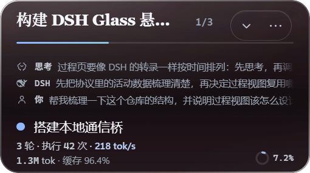
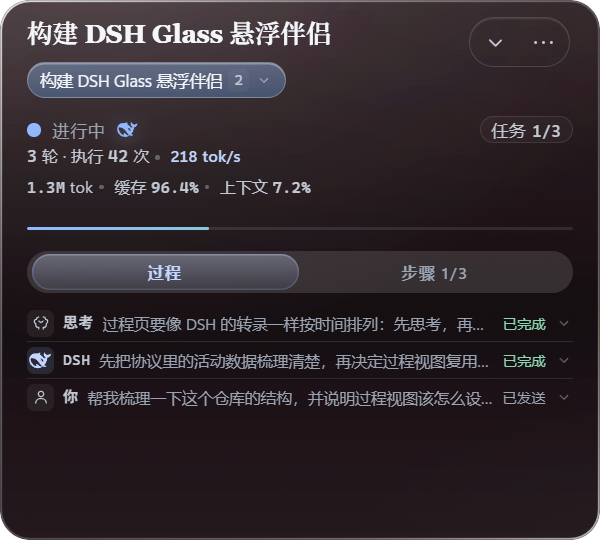
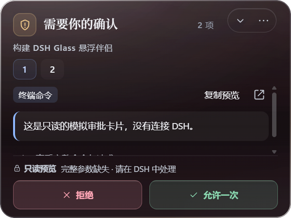
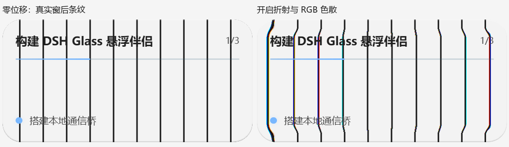
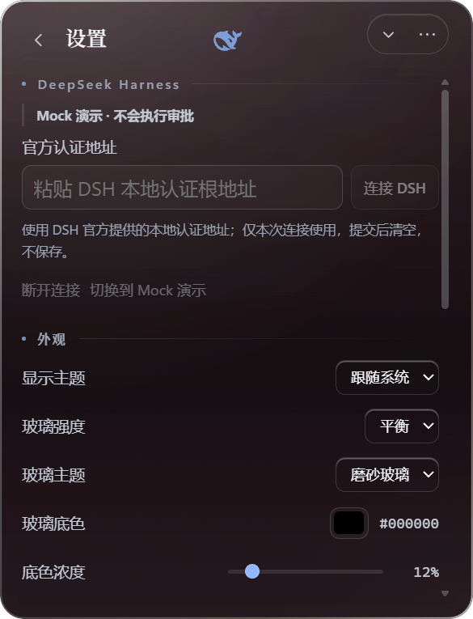

# DSH Status Bar

> **把 DSH（DeepSeek Harness）的任务进度，装进一块会折射的桌面玻璃里。**

像手机上的「灵动岛」：平时是个安静的小胶囊，有事时自己长大，没事时乖乖待着。你可以随手把它拖到屏幕任何角落、拉成顺手的大小。它只是看板 + 传话筒，不抢戏、不越权。

📖 **图文介绍页**：[介绍.html](介绍.html)（可直接用浏览器打开，长图版本见 [介绍.png](介绍.png)）

---

## 📖 这是什么？（30 秒版）

你让 DSH 干活的时候，是不是总得反复切窗口看「跑完没」？**DSH Status Bar** 就是来解决这件小事的——一块液态玻璃小悬浮窗，一直陪你在桌面上：任务跑到哪、下一步干什么、有没有事等你拍板，瞟一眼全知道。

Windows 11 优先，Electron 实现，单实例常驻，不注册托盘图标、不占任务栏。

## 🫧 四副面孔：从小胶囊到审批台

| | |
|:--|:--|
| <br>**胶囊 · 平时**：小鲸鱼标志 + 一行任务名 + 「3 轮 · 42 步」的小字进度。小到可以贴着屏幕边缘安静待着。 | <br>**速览 · 瞟一眼**：会话转录（思考 / DSH / 你）、当前步骤，外加吞吐与缓存这些小仪表。 |
| <br>**紧凑详情 · 看全程**：「过程 / 步骤」双标签，思考、工具调用、消息一条条排开，谁已完成谁已发送一目了然。 | <br>**独立审批 · 拍板时**：「需要你的确认 2 项」，命令先预览再点「拒绝 / 允许一次」，拿不准还能跳回 DSH 原窗口处理。 |

胶囊 288×50 DIP 起，点击长大成速览，再点进入详情；有请求待处理时直接打开审批视图。扩展约 320ms，收起先 80ms 内容退场、再 260ms 原生窗口连续变化。

## 📖 这块玻璃是「真」玻璃

普通悬浮窗只是把背景涂白假装透明；这块玻璃是真的会「看穿」它背后的东西——只取窗后一小块画面（**不保存、不上传**），再用同一套透镜把它折射出来：窗后内容被压弯约 **13 个物理像素**，边缘还带着一丝丝彩虹（RGB 色散）。



> 对照实验（实测存档）：左「零位移」，右「开启折射与 RGB 色散」。拿真实窗后条纹做的实测，不是效果图。

这项能力默认**关闭**，要在设置里手动打开；关闭、隐藏窗口或程序退出时立刻停用。隐私条款就一句话：只看该看的那块，别的不碰。



## 📖 定下的死规矩：按钮永远是你按的

玻璃只是传话筒，不是代理人：

- 审批必须等 DSH 回了正式「已决定」才算数，**绝不抢答**；
- 断线、过期、撤销、参数看不懂？那就只读展示，**绝不自动放行**——任何一次批准都来自你明确的一次点击；
- 连不上就明说连不上，不装作一切正常。

## 📊 数字小卡片

| 132 | 4 | 13 px | 0 |
|:--:|:--:|:--:|:--:|
| 单测全绿（另有类型检查、lint、桌面构建） | 副面孔：胶囊 / 速览 / 详情 / 审批 | 真实折射偏折（实测物理像素） | 次自动放行（永远是 0） |

## 🚀 快速开始

要求：Windows 11 x64、Node.js、pnpm（`packageManager: pnpm@12.4.1`）。

```powershell
pnpm install
pnpm build
pnpm start
```

也可以直接双击 `启动预览.cmd`。开发热更新用 `pnpm dev`。默认是 **Mock 演示**；连接真实 DSH 见下。

### 装成 DSH 插件（推荐）

不用自己 `pnpm build`：插件包里带着构建好的桌面端和 Electron 运行时，装上就能开。开启 DSH 时它会自己把官方认证链接交给玻璃，不用再手动粘贴。

```powershell
dsh plugin --profile web add https://github.com/wfz2006/dsh-status-bar/releases/latest/download/dsh-glass-plugin.tgz
```

装好后重启 DSH，玻璃会跟着启动；不想要它自动开，就在 profile 补丁里写 `- id: dsh-glass-plugin` + `config: { autoLaunch: false }`。细节见 [packages/dsh-plugin/README.md](packages/dsh-plugin/README.md)。

### 连接真实 DSH（实验）

设置 → 官方认证地址 → 粘贴 DSH 启动器输出的认证链接并连接。凭据只留在 Main 内存，断线即失效、不落盘。

```powershell
pnpm test:live   # 隔离 DSH_HOME 下的真实 Host 联调（需要本机已安装 DSH）
```

真实官方 Desktop 的当前任务与真实审批仍未验收，状态以 [支持矩阵](docs/integration-matrix.md) 与 [ADR 004](docs/adr/004-authenticated-host.md) 为准。

## 🛠️ 技术积木

| 组件 | 说明 |
|:--|:--|
| Electron 44 + electron-vite 6 | 悬浮窗本体（`apps/desktop`） |
| React 19 + Zustand 5 | 界面与状态管理 |
| TypeScript（strict） | 全套类型约束 |
| 自研工作包 | `protocol` / `bridge` / `adapters/dsh` / `adapters/mock` / `dsh-plugin` |
| Vitest + Playwright | 单元测试 + 桌面实测脚本 |
| ws | 本地 WebSocket 通信 |

## 📁 项目结构

```
apps/desktop          Electron 悬浮窗（main / renderer / shared + 光学取样助手）
packages/protocol     自研本地协议与数据类型
packages/bridge       宿主桥接
packages/adapters     dsh（真实 Host）/ mock（演示数据源）
packages/dsh-plugin   DSH 插件（bundle：启动桌面端并把认证链接交过去）
tests                 单元测试
scripts               构建、验收、截图与联调脚本
docs                  产品 / 架构 / 协议 / 安全 / 决策文档
reports               每轮真实验收记录与截图（23 个目录）
experiments           Tauri 原生材质对照等实验
```

## 📚 文档索引

- [运行与验收](docs/RUNNING.md)：怎么跑、怎么验、当前材质与偏好
- [产品边界与验收条件](docs/00_PRODUCT_PRD.md)
- [总体架构](docs/01_ARCHITECTURE.md) ｜ [自定义本地协议](docs/02_PROTOCOL.md) ｜ [状态模型](docs/08_STATE_MODEL.md)
- [DSH 集成与已验证接口](docs/04_DSH_INTEGRATION.md) ｜ [安全测试](docs/05_SECURITY_TESTING.md)
- [决策记录](docs/07_DECISIONS.md) ｜ [执行计划](docs/06_EXECUTION_PLAN.md)
- [规格原文](docs/README_SPEC.md) ｜ [实现清单](TASKS.md) ｜ [开发规格](DSH_GLASS_MASTER_SPEC.md) ｜ [UI 重设计规范](DSH_Glass_Liquid_UI_Redesign_Spec.md)
- 真实截图与验收：`reports/`（材质矩阵、四形态、录屏、折射实测、性能、动效等）

## 📌 当前状态

- 四形态 UI（任务胶囊 / 速览 / 紧凑详情 / 独立审批）已落地，偏好本地持久化，手动尺寸不被新请求覆盖。
- 150% DPI 下拖动「窗口自己越长越大」的 bug 已修复：移动只挪位置，不再改动尺寸。
- 真实折射与 RGB 色散已用真实窗后条纹实测（13 px 偏折），隐藏 / 停用 / 实色 / 异常退出均有回归；正式入口仍为 Electron。
- 审批只在收到匹配的 `approval/decided` 后确认；提问只在权威回执后确认；无法验证的参数保持只读。
- 仍有未验区域：真实用户 Desktop 任务、模型驱动的审批/提问尚未完成实机闭环，见 [ADR 004](docs/adr/004-authenticated-host.md)。

## 说明

- 主要服务 Windows 11 x64；macOS / Linux 暂不承诺。
- 不替代 DSH 本体：不写代理模型、会话引擎、工具运行器。
- 本项目以 [MIT License](LICENSE) 开源；引用或二次分发请保留版权声明。
