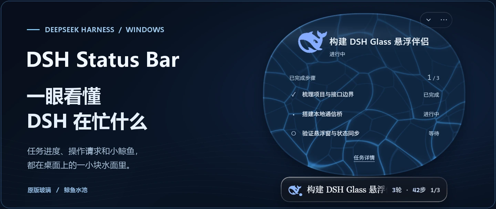
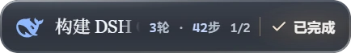
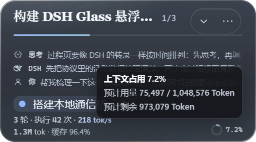
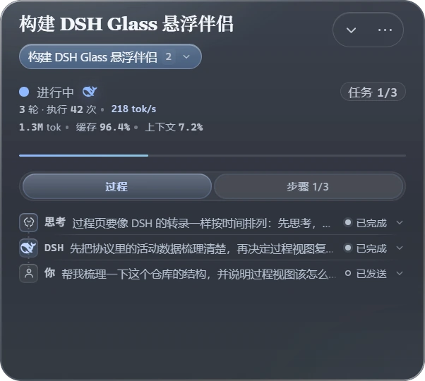
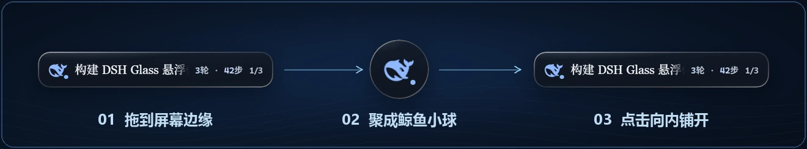
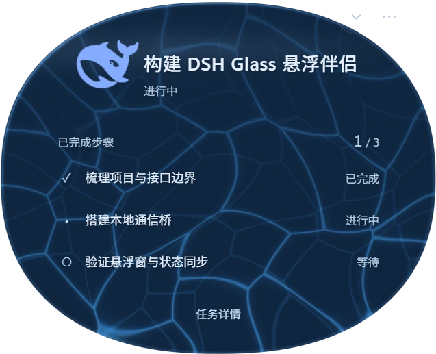
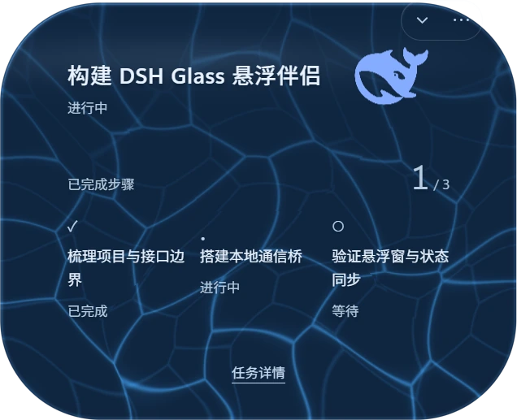
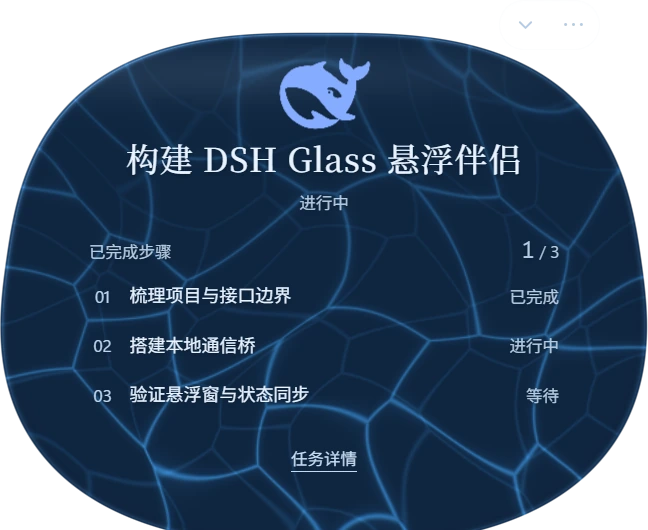
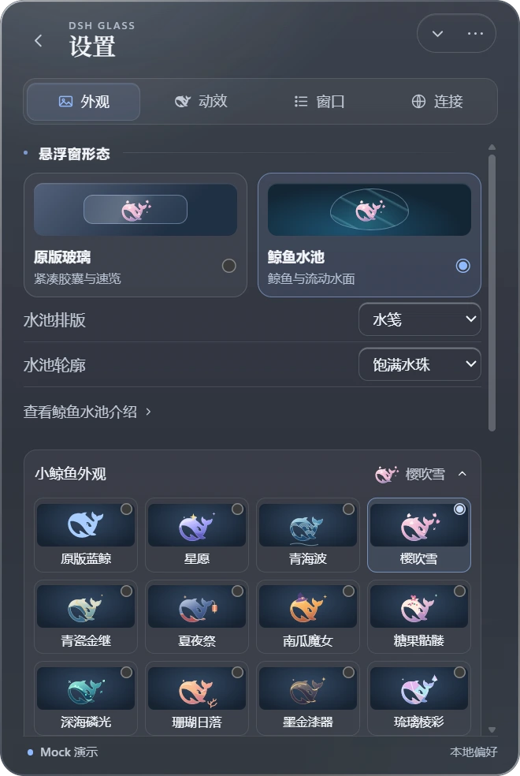
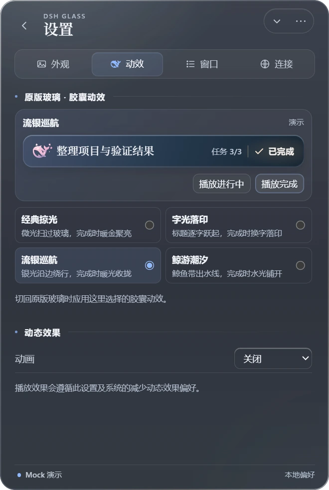

# DSH Status Bar

> 在 Windows 桌面上看 DeepSeek Harness 的任务进度、会话和待处理请求。



[下载安装](#安装与启动) · [切换外观](#两种外观) · [从源码体验](#从源码体验) · [Releases](https://github.com/wfz2006/dsh-status-bar/releases)

## 一瞥就知道任务走到了哪

让 DSH 跑任务时，可以继续留在编辑器里。胶囊显示当前会话和进度，点击打开速览，再打开详情就能查看过程、工具调用和步骤。运行中的会话在列表里有单独的状态提示，完成时胶囊用光效和文字给出反馈。



| 速览 · 任务与用量 | 详情 · 过程与步骤 |
| --- | --- |
|  |  |
| 将指针移到占用量圆环上，查看当前上下文的预计用量和余量。 | 切换会话，查看当前任务的工具执行和消息，也可以切到步骤列表。 |

## 两种外观

### 原版玻璃

胶囊、速览、详情和待处理请求各有自己的视图。原版玻璃可以调整底色、透明度和亮度，也可以切换到磨砂或实色。启用真实折射时，应用只取样悬浮窗后方及少量边距，在本机生成折射与色散，隐藏窗口后暂停取样。



将胶囊拖到屏幕边缘并松手，玻璃会聚成一颗鲸鱼小球。点击小球，胶囊沿贴住的一侧向屏幕内展开。开关在 **设置 → 窗口 → 靠边自动收纳**。

### 鲸鱼水池

收起时是一只会摆尾、吐泡的小鲸鱼。点击后，鲸鱼横向游过，水痕铺成任务面板，海底光纹在水面内流动。你可以在 **设置 → 外观** 分别挑选水池排版和轮廓。

| 清流 · 饱满水珠 | 轻舟 · 柔角水镜 | 水笺 · 圆头水滴 |
| :---: | :---: | :---: |
|  |  |  |

首次安装，或首次从旧版更新到支持鲸鱼水池的版本时，会弹出一次介绍。可以当场试用，也可以日后在外观设置里打开。

## 给小鲸鱼换个样子

| 设置 → 外观 | 设置 → 动效 |
| --- | --- |
|  |  |
| 原版蓝鲸加 13 款造型。星愿、樱吹雪、南瓜魔女和深海磷光等外观可在两种形态里共用。 | **经典掠光、字光落印、流银巡航、鲸游潮汐** 均可预览运行与完成效果。动画支持完整、减少和关闭。 |

以上截图来自 Windows 上运行的 Electron 开发版，任务内容为 Mock 演示数据。

## 安装与启动

项目面向 **Windows 11 x64**。当前发行版为 **v0.3.0**。本页的靠边收纳、新设置、鲸鱼外观和胶囊动效展示的是更新后的源码，使用下方的源码步骤可以体验。

在已安装 DSH CLI 的终端运行以下任一命令。

```powershell
# 通过 npm 安装插件，首次启动时下载对应的运行时
dsh plugin --profile web add dsh-status-bar-plugin

# 或使用自包含的发行包
dsh plugin --profile web add https://github.com/wfz2006/dsh-status-bar/releases/latest/download/dsh-status-bar.tgz
```

重启 DSH 后，插件会启动悬浮窗并连接当前宿主。隐藏后按 `Ctrl+Shift+G` 恢复，退出后可以在 DSH 会话里输入 `/status-bar` 重新打开。自动启动和自定义 Profile 的说明见[插件文档](packages/dsh-status-bar/README.md)。

## 从源码体验

准备 Node.js 22.12 或更高版本和 pnpm 12.4.1。在仓库根目录执行。

```powershell
pnpm install --frozen-lockfile
pnpm build
pnpm start
```

启动后可以通过窗口菜单开启 **Mock 调试**。连接本机 DSH 时，从 **设置 → 连接** 使用官方启动器提供的认证地址。

## 连接与待处理请求

待处理请求可以打开独立的审批视图。只有会话、工具请求和授权身份匹配时，应用才允许提交决定。界面以 DSH 的正式回执为准，断线、超时或请求身份无法校验时保持只读。真实 Desktop 上由模型触发的审批和问答仍待实机闭环验收。[接入支持矩阵](docs/integration-matrix.md)

源码验证可运行 `pnpm lint`、`pnpm typecheck` 和 `pnpm test`。更多资料见[运行与验收](docs/RUNNING.md)、[架构](docs/01_ARCHITECTURE.md)、[协议](docs/02_PROTOCOL.md)和[鲸鱼水池](docs/whale-pool-form.md)。

本项目采用 [MIT License](LICENSE)。
