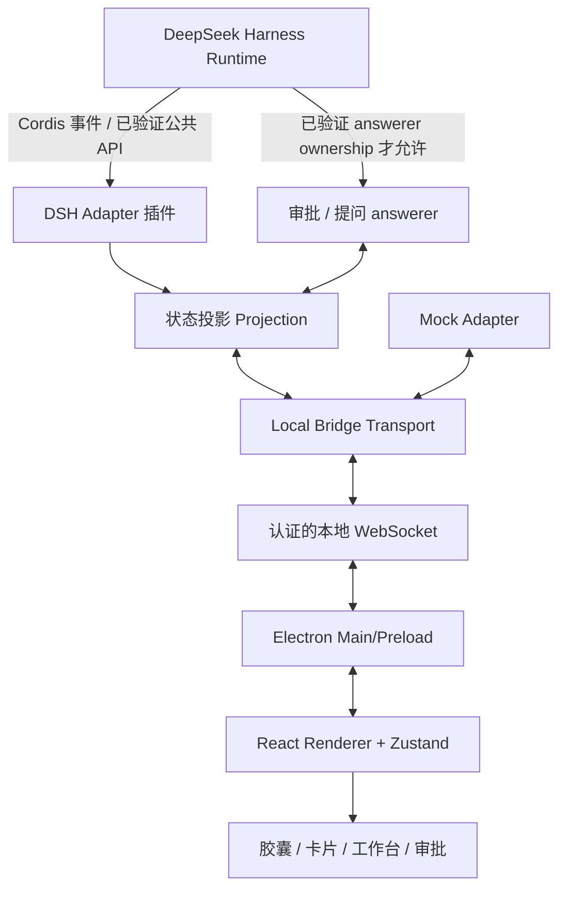

# 01 — 技术架构与组件边界

## 1. 核心思路

采用**可替换 DSH Adapter + 本机 Bridge + 独立 Electron Window** 的架构，不对已签名官方 DSH Desktop 可执行资源做任何修改。



注意：图中的 DSH `AC` 只代表**经过证明的可选集成模块**；在官方 Desktop answerer 所有权未验证前**不得启用**。

## 2. 建议仓库结构

```text
dsh-glass/
├─ apps/desktop/
│  ├─ electron/main/          # BrowserWindow/tray/IPC/连接生命周期
│  ├─ electron/preload/       # 类型化白名单 IPC
│  └─ src/
│     ├─ features/{capsule,todo,approval,question,sessions}/
│     ├─ components/glass/
│     ├─ stores/
│     ├─ styles/
│     └─ app/
├─ packages/
│  ├─ protocol/              # 协议 Schema/TS 类型，前后端共享
│  ├─ bridge/                # 本机鉴权 / WS / 事件缓存 / ACK
│  └─ adapters/
│      ├─ mock/               # 无 DSH 时的确定性演示源
│      └─ dsh/                # Cordis 插件 + API capability 实验
├─ docs/                     # 本规格包
├─ tests/                    # integration/e2e/fixtures
├─ AGENTS.md
└─ TASKS.md
```

## 3. 组件职责

### DSH Adapter

- 在运行时进程中从**真实** DSH 事件/服务获取变化。
- 采用会话身份映射 `runtimeId + sessionId`，准确提取持久事件序号（若版本提供）。
- 提供 `getSnapshot()` 或适配器等价能力（需要 target DSH 版本验证）；无 API 时采用可证明的重建策略。
- 不关心窗口状态/视觉，不持有 Electron 对象。
- 不在未经所有权确认前注册工具审批 answerer；只展示已可安全获取的审计事实。

### State Projector

- 将真实 session log、agent 状态转为 `SessionView`，不泄露原始对象引用。
- Todo 整体替换，按 Session 单独存储。
- 以 `callId` 将请求与已经流出的 `tool/call` 关联，工具参数受脱敏策略保护。
- `session.status` 不足以推断是否正在等待人类时，以独立 pending request 状态表示。
- 会话关闭或连接中断时，将审批状态降为不可提交。

### Local Bridge

- 默认仅绑定 `127.0.0.1`，不对外暴露端口；随机令牌启动/轮换。
- 每个客户端认证且最小权限；握手检查 `protocolVersion`、`sourceRuntimeId`、capabilities。
- 向 UI 发送有版本的快照和增量；支持可恢复重连。
- 接受 `approval.respond` 请求时校验 UI 请求身份、epoch、Session owner、pending 状态、防重放。
- 不做自动授权；提交后真实决议才回 ACK。

### Electron Main & Preload

- 单实例锁、托盘、窗口放置、多屏、DPI、关闭/隐藏、热键与置顶。
- Renderer 沙盒化，无任意 IPC；Bridge token 存于 Main 进程，preload 只暴露窄且类型化的方法。
- 不允许通过外部链接调用系统 shell 或打开任意文件。
- IPC channel 只包含窗口 UI 需要的命令及数据，协议层校验每个 payload。

### React Renderer

- 根据已归一化 ViewModel 渲染，**不直接调用 DSH Cordis、SDK 或文件系统**。
- 展示不同信息密度断点与用户偏好；兼容键盘与 reduced-motion。
- 审批按钮只产生提交意图，最终状态来自服务端确认。

## 4. Observe/Control 双能力模式

| 模式 | 数据来源 | 是否可提交决策 | 何时启用 |
|---|---|---|---|
| mock | MockAdapter | 仅虚拟数据，绝不触发真实操作 | 日常 UI 开发 |
| observe | DSHAdapter | 不可以 | 接入验证成功，审批通道未知 |
| control | DSHAdapter + verified answerer | 可以（逐个请求显式批准） | Ownership、安全 E2E 全通过 |

启动时通过 `capabilities` 广播精确能力；UI 不允许根据“看到了审批事件”推断可提交审批。

## 5. 关键设计问题

### Q1：如何同时使用官方 DSH Desktop 和 Glass？

Desktop Profile 与 CLI Web Profile 分离。必须先验证官方 Desktop 的插件管理器是否允许正常加载插件，以及插件所在进程与 Session owner 是否一致。不能使用 `dsh --profile desktop` 命令绕过官方限制，不能改装已签名 `app.asar`。

优先路线：**官方 Desktop 插件功能加载独立 dsh-adapter，Bridge 通过正常插件进程对外提供能力**。若无法完成，优先交付 Web Profile 的观察版或官方 Desktop 的只读公共 API 适配，而不是盲目对接内部私有端口。

### Q2：审批请求可否通知多个 UI？

`approval/request` 是 waterfall：首个 owner answerer 决定，请求不能由两个 UI 任意竞争。因此控件入口必须通过所有权可验证的“唯一决策者”或支持的上游协作方式完成。若无安全支持，只读并使用“在 DSH 处理”入口。不得在日志层仅看到 `approval/asked` 后伪造 answerer。

### Q3：如何避免瞬时状态不一致？

Bridge 初次连接或重连生成完整快照，并以 generation/epoch 标记，客户端只接受匹配会话的增量。不能仅使用网络到达顺序；每条增量以 source sequence 去重，并在 gap 出现时触发 `snapshot.request`。

### Q4：用户退出 Glass，DSH 会怎样？

仅退出悬浮层，不主动停止 DSH Agent，也不替代 DSH 的生命周期管理。控制模式若 Glass 唯一持有 answerer，退出前必须先将所有待决请求以安全方式退回/失败关闭，并向用户说明：不能保证原 DSH UI 会接管。后台无法运行时退回 observe 模式或明确不可用。

## 6. Windows 窗口技术边界

Electron 无边框窗口 + `resizable: true`。系统背板使用 `setBackgroundMaterial('acrylic')`，**前提 Windows 11 22H2+** 且实际窗口参数兼容；失败时 CSS 半透明模糊材质降级。不要仅靠网页 `backdrop-filter` 声称实现了系统级桌面模糊；必须实测组合是否有效。

- 主窗口透明并不等于 Acrylic 可用；将“native acrylic supported”作为独立 capability。
- `setIgnoreMouseEvents` 必须有可靠的恢复入口（托盘/快捷键），审核交互下默认关闭。
- 拖拽区使用 `app-region: drag`（具体 Electron 版本验证），按钮等交互元素 `no-drag`。
- 窗口的像素空间使用 Electron 的 DIP（逻辑像素）并根据 display workArea 恢复边界。

## 7. 数据持久化

持久化**本地偏好**（主题、尺寸、位置、置顶、安静模式），而非原始 DSH 会话或聊天记录。存储使用 schema version 和配置迁移。禁止明文存 WS token；默认每次进程启动刷新 token。

## 8. 推荐依赖关系

`protocol` ← `bridge` / `desktop` / `dsh-adapter` / `mock-adapter`; `bridge` ← `dsh-adapter` 与 `mock-adapter`（接口注入）；`desktop` 只依赖 protocol 与 Bridge 客户端，尽量不直接加载 DSH runtime package。
