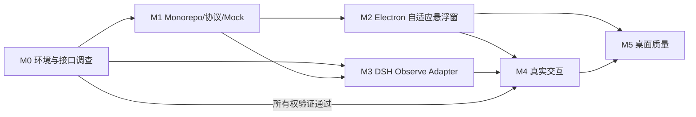

# 06 — Codex 迭代实施计划

## 1. 总体路线与依赖

M4 **有硬性 Go/No-Go**：审批 ownership 不能安全验证时，将其标记 BLOCKED；M5 允许以 observe-only Beta 形式继续，而不是试图强制破解 DSH Desktop。

## 2. M0：技术摸底与设计冻结

**输入**：本规格包、开发环境、目标 DSH 安装。

**输出**：`docs/integration-matrix.md`、`docs/local-source-signatures.md`、环境记录，最小真实 Cordis 插件加载证据。

**步骤**：

1. 确认安装版本、平台、宿主运行方式。
2. 读取 DSH 官方目标版本源代码与 generated API catalog。
3. 以最小 plugin 测试 Web/Profile 加载、session/event 获取。
4. 探测 Desktop Profile 插件装载能力和审批所有权。
5. 决定：`observe-only`、`control-enabled` 或 `blocked`。形成 ADR。

**完成条件**：能够准确指出哪些功能在真实 DSH 中已证实、哪些尚未证实；必须给出日志/测试证据。

## 3. M1：基础工程与 Mock 协议闭环

**输入**：M0 支持矩阵（但即便 M0 接入失败，Mock 可平行推进）。

**输出**：Monorepo 目录、完整自定义协议类型、Mock 事件源、Bridge 安全会话、Store 纯函数、基本测试。

**最小演示**：Mock 会话先出现三个 Todo，随后整体替换为两个；Renderer 正确更新且无旧项残留。模拟断线后批准按钮不可用。

**完成条件**：类型检查、测试、格式检查均通过；UI 数据来源明确标注 Mock。

## 4. M2：UI/窗口 MVP

**输出**：Electron Main、Tray、受限 Preload、React、3+ 自适应断点、玻璃降级材质。

**重点任务**：

- 初始尺寸 Capsule，拖动可以进入 Compact 和 Workspace，不使用 CSS `transform: scale(...)` 全窗缩放。
- `resize`/`move` 持久化用户意图，双击恢复；多屏工作区坐标保护。
- 重要状态清晰，支持无 Todo、多 `in_progress`、多 Session、未知状态。
- 适配 Windows 11 材质，出现兼容问题时切换成纯色/透明替代方案。

**完成条件**：即使断开真实 DSH，Mock 可以展示完整交互原型；窗口操作稳定。

## 5. M3：DSH 真实观察模式

**输出**：可安装的 Cordis Adapter（先 Web Profile，随后 Desktop Profile）；最小状态投影；断线后同步。

**重点任务**：

- 从 `session/event` 分辨持久 `todo/write`、`tool/call` 等事件。
- 通过每个 Session 的真实序号处理数据，记录不支持场景。
- 以 `callId` 关联工具请求和展示信息；参数谨慎脱敏。
- 若 DSH Profile 的 API 不能给出会话快照，必须设计断线重新订阅/可证明回放，不能凭猜测生成数据。

**完成条件**：关掉/隐藏 DSH 主窗口后，仍可监测有真实后台运行的任务（若该 DSH 运行模式支持）；观察模式可复现实验。

## 6. M4：审批与用户回答

**硬前提**：M0-05 已验证安全单 answerer 或官方支持的委派机制；否则不开始真实批准实现。

**输出**：请求队列、审批详情、提交/ACK/真实 outcome、取消/失败处理，多会话隔离；问题回答（P1）。

**步骤**：

1. 先做 readonly approval.requested UI 和不可操作卡片。
2. 有安全所有权证据后，实现短生命周期的 pending request Registry。
3. 实现完全关联 requestId、sessionId、runtimeId、epoch 和 `callId` 的提交。
4. 实现拒绝，确认无副作用，再实现允许一次。
5. 启用 E2E 安全回归；失败即自动降级 observe。
6. `user-questions/request` 独立 state/adapter 实现。

**完成条件**：所有 E2E-A 至 E2E-E 通过；否则仅展示只读审批提醒。

## 7. M5：质量与分发

**输出**：Windows 自测包、使用文档、故障/卸载说明、支持矩阵、性能证据。

必须覆盖：多 DPI、多屏、系统休眠、原生 Acrylic 不兼容回退、Tray、开机启动可选、真实与 Mock 模式清楚区分、敏感参数遮罩、安全拦截。

## 8. 并行化建议

可并行：

- Agent A：`protocol`/`bridge` 与 tests。
- Agent B：Electron 窗口和 UI，依赖 Mock Adapter。
- Agent C：DSH Adapter 探测、集成矩阵和事件签名。

**冲突控制**：共享协议由 A 维护，其他 Agent 不得自行发明字段；M4 仅由一个专门 Agent 在 M0 通过之后实施。建议以 PR/分支合并，每次同步协议版本并执行集成测试。

## 9. 每轮 Codex 工作模板

1. 从 `TASKS.md` 挑一组有依赖保障的任务（建议同一里程碑 1–3 个）。
2. 阅读所有涉及文件及官方已验证签名。
3. 描述修改范围与失败回退方案。
4. 实现代码+测试，运行 lint/typecheck/test；必要时执行桌面实测。
5. 更新 `TASKS.md`，给证据链接或测试日志。
6. 本轮总结：已完成、已验证、仍受阻、下一次最小任务。

## 10. 发版判断

| 状态 | 对用户承诺 | 是否可发布 |
|---|---|---|
| Mock only | UI Demo，不接入真实 Agent | 仅开发预览 |
| Observe PASS | 查看真实任务、Todo、活动，但审批请回官方 DSH | 可以发布只读 Beta |
| Control PASS | 当前已测试版本支持真实允许/拒绝/问题回复 | 可以发布受限版本 |
| Unknown / fail | 无法保证数据/审批真实性 | 禁止宣传对应能力 |
