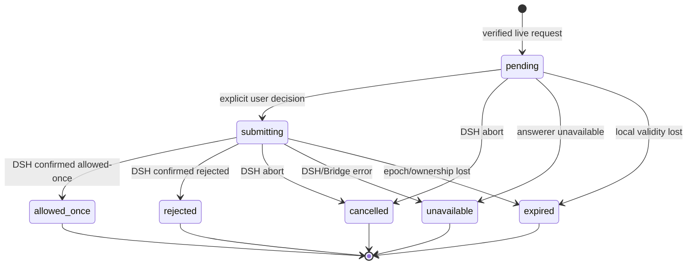
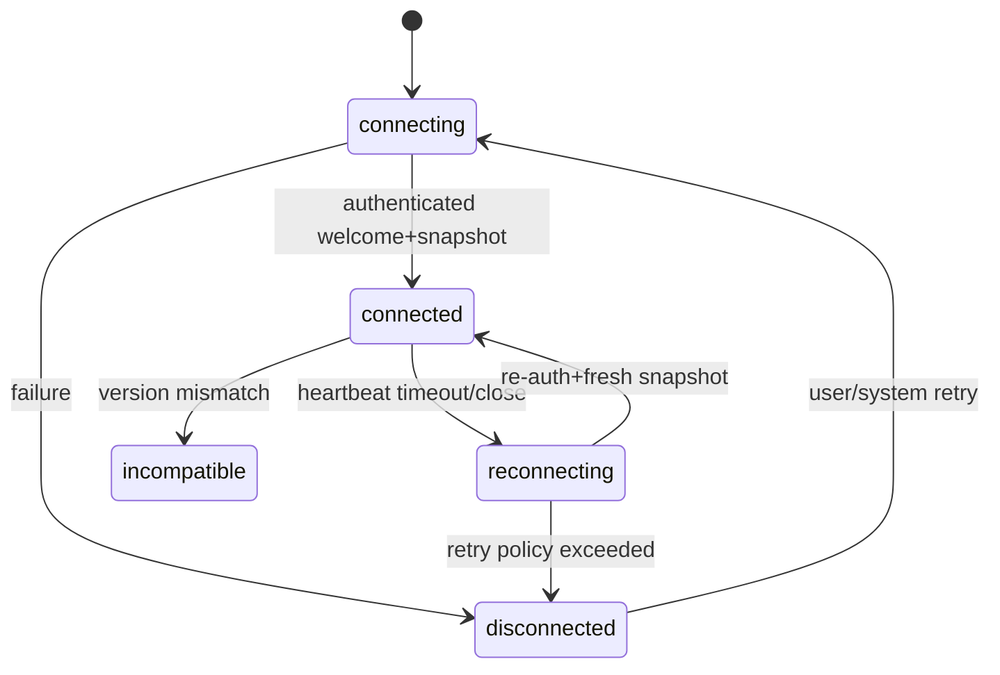

# 08 — 状态机、投影与事件一致性

## 1. 状态空间分离

切忌用一个 `status = 'running' | 'approval' | 'idle'` 表示所有状态。应至少独立建模：

1. Transport：connecting/connected/reconnecting/disconnected/incompatible。
2. Agent：running/idle/unknown（具体值通过 DSH Adapter 映射）。
3. Interaction：none/pending-approval/pending-question（可同时多请求）。
4. Session lifecycle：active/ended/unknown（仅基于真实事件）。
5. Presentation：capsule/compact/task-card/workspace/expanded（基于尺寸）。

Presentation 是上面状态的展示结果，不反向修改 Agent 真实状态。

## 2. Todo 投影规则

```typescript
function applyTodoSnapshot(
  previous: { sourceSeq: number; todos: Todo[] } | undefined,
  incoming: { sourceSeq: number; todos: Todo[] }
) {
  if (previous && incoming.sourceSeq <= previous.sourceSeq) {
    return previous; // 重复或过期
  }
  return { sourceSeq: incoming.sourceSeq, todos: [...incoming.todos] };
}
```

前提：同一个 sourceSeq 在目标 DSH 版本内可单调排序。**Todo 专属流序号可以跳号，因为它可能继承了所有 Session 事件的 seq**；跳号本身不说明丢包。只有全量连续事件流或 Bridge 自己的连续传输序号出现 gap 时才能触发重拉。若无可靠源序号，Adapter 负责提供投影版本并说明快照原子性。完整 snapshot 可替换全部 Store，不能拿事件列表当增量 diff。

进度：`completedTodos / totalTodos` 只作为**Todo 步骤比例**。`totalTodos === 0` 不显示百分比。`in_progress > 1` 显示多个并行活动。`completed === total` 不自动判定 Session 结束。

## 3. 审批状态机



`submitting` 时不允许再次点击；客户端丢失状态后不能自行把 pending 标为已批准。DSH 官方 status `cancelled/unavailable` 都是非授权终态。

### 多个 pending request

记录 `Map<runtimeId + sessionId + requestId, ApprovalView>`。请求 ID 不要从 callId 或 toolName 生成；原始 DSH ApprovalRequestId 必须保留到匹配过程。跨 Session 绑定失败，Bridge 拒绝操作。

## 4. 连接生命周期



进入 `reconnecting` 后要立刻把所有 approval actionable 设 false；旧请求在新快照中明确仍 pending 且有所有权才能恢复。重连可以自动继续**观察**，不能自动继续**审批动作**。

## 5. 例外场景

- DSH 只提供审计事件而没有 live 请求：可显示观察到审批状态，但不能设 actionable。
- 延迟的 `approval.ack` 来自旧 epoch：直接忽略并记录安全告警。
- Agent idle 但有 live pending-approval：界面优先显示等待审批，不误写为“已完成”。
- 运行中取消 Todo 项：新快照里项消失就是来源事实，不需要保留旧项为 deleted。
- 工具调用详情分片缺失：展示“参数暂不可用”，拒绝对高风险动作显示安全判断。
