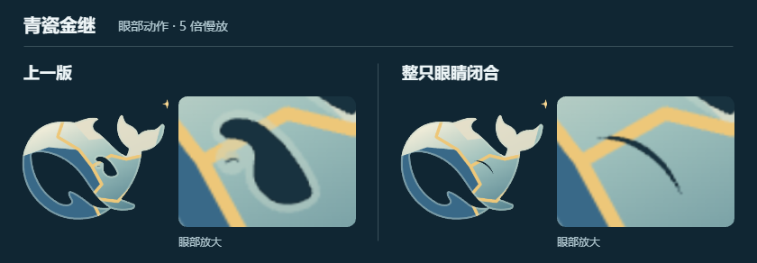

小蓝鲸现在会用整只眼睛眨眼。小圆点和旁边的深色弯形眼区一起闭合，收成一道弧线，再睁回原来的眼形。这个动作适用于全部 16 款外观。



## 水池里的变化

- **任务和动作对得上。** 任务运行时鲸鱼巡游，等你回答时停下倾听，输入时轻轻点头。收到任务完成事件会庆祝一次，重新打开已完成的任务时会安静休息。
- **等候也有反馈。** 提交回答或审批后，鲸鱼会等待宿主回执。掉线时进入断线姿态，重连后跟随当前会话。切走再回来，同一个待答问题可以接着写。
- **多了两款装扮。** 在「设置 → 外观」里可以选「星夜蓝」和「海盐水手」。使用减少动态效果时，鲸鱼保留静态姿态。使用 Canvas 2D 回退时也能完整眨眼。

我们在 Windows 11、150% 显示缩放下做了 116 条侧边收纳与动画中断回归路径，并在官方 0.2.2-rc.3 宿主上跑通提问、拒绝和允许一次的完整回执流程。lint、类型检查、生产构建和 25 个文件的 254 项测试通过。

## 安装到 Windows 11 x64

在装有 DSH CLI 的终端运行以下命令，然后重启对应的 DSH 宿主。

```powershell
dsh plugin --profile desktop add https://github.com/wfz2006/dsh-status-bar/releases/download/v0.4.2/dsh-status-bar.tgz
```

使用 Web 宿主时，把 `desktop` 换成 `web`。也可以从 npm 安装 `dsh-status-bar-plugin@0.4.2`。
