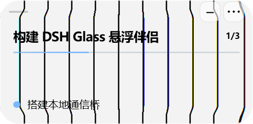
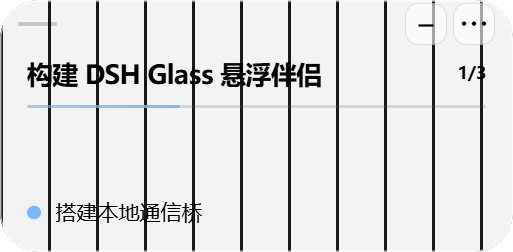

# 限定区域的真实桌面折射

2026-10-17。用户明确授权“允许限定区域取样，继续实现折射和色散”后实现；本轮不把旧DOM壁纸测试当作真实桌面验收。

## 结果

真实独立原生窗口绘制黑白条纹，置于Glass后方。C# helper只取样本框物理矩形及24 DIP边距（每边最多48物理px），传入Canvas，再由参考项目SDF/RGB滤镜处理。输入584×324、灰阶24–238、彩色像素0，证明没有混入Glass自己的彩色进度条/文字。Glass通过Windows WDA_EXCLUDEFROMCAPTURE排除自身，helper每次验证该标志。

同一真实输入的正常/零位移对照，在空白中段（排除文字/按钮/进度）测得：4582像素改变、1276像素出现RGB分离（零位移0），条纹最大偏折13物理px。`refracted.png` / `zero.png` 是渲染器输出截图，**输入来自实际原生窗后像素**，不是DOM壁纸或生成图；因本窗被排除系统抓屏，不能伪称它们是无干预全桌面录屏。

两图并列版本：`comparison.png`。透明窗口/真实取样/滤镜的能力边界分别验证，没有把捕获到画面当作偏折成功。

## 生命周期与范围

- 默认关闭；普通启动需在设置勾选“真实折射与色散”。显式`--desktop-optics`启动参数是本次启动的主动开启，不持久化。
- HWND固定为Main自己的Glass、PID匹配；renderer不能指定窗口/矩形/进程、不能读取全屏。只发送该矩形和受限边距内的RGBA。
- 捕获前后复核覆盖、身份、可见性和排除标志；Main按当前物理bounds重投影并裁剪，缺覆盖时不发送。移动即时调整画布的世界坐标，无覆盖时隐藏旧纹理。最新拖动修复见 `../drag-optics/README.md`。
- 单帧在途；小区域25Hz上限，大区域15/8Hz上限；不是显示帧率承诺。本次实测输入约17Hz，长时间性能与高DPI矩阵未验收。
- 隐藏/最小化停止助手、显示恢复；切实色/Acrylic或错误立即停用；关闭开关清画布、停止帧传输并取消自身排除标志。主进程退出关闭管道，助手随EOF退出。
- 图像不写文件、日志或网络；只在内存中传递。测试图片仅为自有条纹夹具。

已修正蓝灰整面染色/渐变，取消文字白边/阴影，标题600字重；没有额外添加整面颜色或假壁纸。

## 验证

`pnpm lint`、`pnpm typecheck`、32项单测、构建、清透实字检查通过。真实光学脚本验证默认关闭、布尔IPC边界、无自身递归、限域输入、偏折/色散、四形态、移动、隐藏停止/恢复、实色停止、helper异常安全停止与重新开启。独立代码审查指出的流错误、旧位置帧、重复复制及实色仍取样问题均已修复并复核。

复现：`pnpm build`，`node scripts/desktop-optics-acceptance.mjs`，Python运行 `scripts/analyze-desktop-optics.py`。`acceptance.json`、`sample.json`、`pixel-analysis.json` 是本次结果。真实DSH接入/审批仍BLOCKED；本轮仅Mock界面与真实桌面材质。

本轮细边/浅底/纯黑文字修改后重跑通过，单测现34项。紧凑排版改变进度条位置，旧分析脚本的固定比例区域混入进度颜色；现由DOM测量进度条与当前步骤之间的真实空白区，保留原色散/零位移阈值。最新样本3776变化像素、704色散像素，零位移色散0，最大条纹位移14.5物理px；输入约19Hz。只证明当前受控样本，不代表显示帧率。
